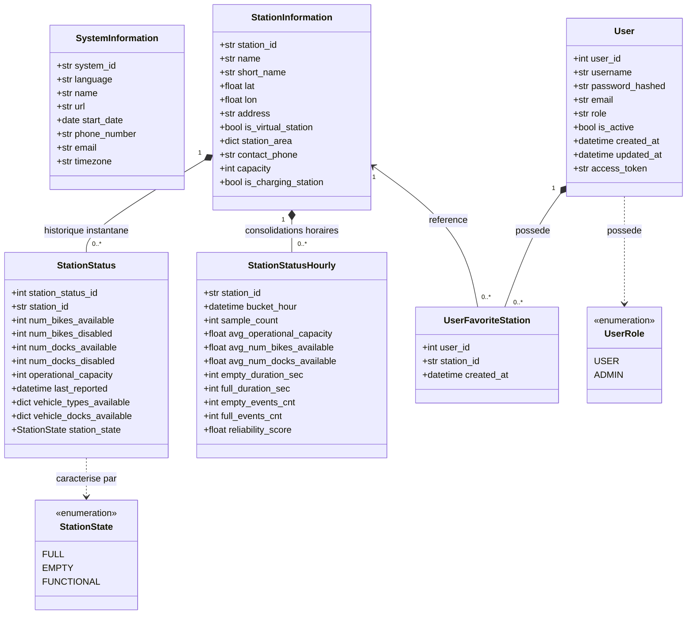
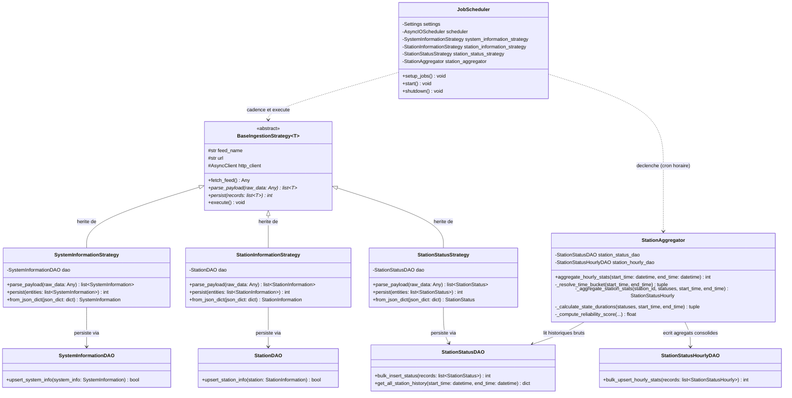

# Diagrammes de classes de l'application VeloScope

Afin de répondre aux exigences de clarté, de maintenabilité et de lisibilité architecturale (notamment suite aux retours de l'évaluation intermédiaire), la modélisation orientée objet de VeloScope est découpée en **trois diagrammes cohérents et indépendants** :

1. **Le modèle domaine et entités métier (Business Objects)** : Objets purs représentant le domaine d'affaires ;
2. **L'architecture logicielle du Web Service (Contrôleurs, Services et DAOs)** : Chaîne synchrone de traitement des requêtes HTTP ;
3. **Le sous-système asynchrone d'ingestion et d'agrégation (Background Jobs)** : Pipeline asynchrone d'ETL et de consolidation statistique cadencé par `APScheduler`.

---

## 1. Modèle de domaine et entités métier (Business Objects)

Les entités métier constituent le socle de l'application. Ce sont des objets purs (*Plain Old Python Objects*), dépourvus de dépendances vers des bibliothèques d'infrastructure (FastAPI, SQL, HTTP).

### Justification des choix de modélisation métier

1. **Partitionnement temporel entre télémétrie brute (`StationStatus`) et consolidations (`StationStatusHourly`)** :
   - `StationStatus` consigne les flux à haute fréquence (toutes les 5 minutes), générant environ 30 000 lignes par jour pour 100 stations (> 1 million par mois).
   - `StationStatusHourly` précalcule par tranche horaire les métriques de disponibilité et le score de fiabilité. Pour restituer l'historique d'une station sur 7 jours (F3), l'API n'interroge que 168 lignes pré-agrégées via l'index `(station_id, bucket_hour)`, assurant un temps de réponse constant en quelques millisecondes sans balayage de table massif (*full table scan*).
2. **Utilité directe de chaque attribut collecté** :
   - Coordonnées GPS (`lat`, `lon`) et capacité physique : calculs de distance (formule de Haversine) et taux de saturation pour le moteur de recommandation (F5).
   - Dictionnaire `vehicle_types_available` : permet de filtrer spécifiquement la disponibilité par type de vélo (mécanique vs assistance électrique).
   - Compteurs d'incidents (`empty_events_cnt`, `full_events_cnt`) et durées (`empty_duration_sec`, `full_duration_sec`) : variables d'entrée fondamentales pour le calcul du score de fiabilité composite (F4).
3. **Sécurité et intégrité (`User`)** :
   - Hachage cryptographique du mot de passe avec `bcrypt`, gestion des rôles applicatifs (`UserRole`), et drapeau d'activation logique (`is_active`) pour la désactivation de compte sans rupture des clés étrangères.

---

## 2. Architecture logicielle du Web Service (Contrôleurs, Services et DAOs)

Le Web Service VeloScope regroupe les composants concourant au traitement synchrone des requêtes des utilisateurs et des administrateurs. 

Afin de répondre directement aux remarques formulées sur l'architecture en couches, les classes sont présentées de manière strictement ordonnée de haut en bas (**Contrôleurs $\to$ Services $\to$ DAOs $\to$ Base de données**), sans dispersion.

```mermaid
classDiagram
    direction TB

    %% ==========================================
    %% COUCHE CONTRÔLEURS (FASTAPI ROUTERS)
    %% ==========================================
    class AuthAndUserController {
        -UserService user_service
        +signup(payload: SignupRequest) MessageResponse
        +login(payload: LoginRequest) LoginResponse
        +logout(user: User) MessageResponse
        +get_user_info(user: User) UserResponse
        +update_user_info(payload: UserUpdateRequest, user: User) MessageResponse
    }

    class StationController {
        -StationService station_service
        +get_station_info(station_id: str) StationInfoResponse
        +list_stations(payload: StationSearchRequest) list~StationInfoResponse~
        +get_station_current_status(station_id: str) StationStatusResponse
        +get_stations_current_statuses(station_ids: list~str~) dict~str, StationStatusResponse~
        +get_station_history(station_id: str, period: TimePeriod) list~StationStatusResponse~
        +get_nearby_recommendations(payload: StationRecommendationRequest) list~StationRecommendationResponse~
    }

    class FavoriteStationController {
        -FavoriteStationService favorite_service
        +add_favorite(station_id: str, user: User) MessageResponse
        +list_favorites(page: int, size: int, user: User) list~StationInfoResponse~
        +remove_favorite(station_id: str, user: User) MessageResponse
    }

    class AdminController {
        -UserService user_service
        +list_users(payload: UserSearchRequest, admin: User) list~UserResponse~
        +activate_user(user_id: int, admin: User) MessageResponse
        +deactivate_user(user_id: int, admin: User) MessageResponse
        +delete_user(user_id: int, admin: User) MessageResponse
    }

    %% ==========================================
    %% COUCHE SERVICES (LOGIQUE MÉTIER)
    %% ==========================================
    class UserService {
        -UserDAO user_dao
        +signup(dto: dict) bool
        +login(username: str, password_hashed: str) LoginResponse
        +logout(user_id: int) bool
        +get_user_by_id(user_id: int) User
        +list_users(query_params: UserSearchRequest) list~User~
        +update_user(user_id: int, updates: dict) bool
        +delete_user(user_id: int) bool
    }

    class StationService {
        -StationDAO station_dao
        -StationStatusDAO status_dao
        -StationStatusHourlyDAO hourly_dao
        +get_by_id(station_id: str) StationInformation
        +list_stations(payload: StationSearchRequest) list~StationInformation~
        +get_station_current_status(station_id: str) dict
        +get_stations_current_statuses(station_ids: list~str~) dict~str, dict~
        +get_station_history(station_id: str, time_period: TimePeriod) list~dict~
        +get_nearby_recommendations(criteria: StationRecommendationRequest) list~dict~
        -compute_full_ratio(num_bikes: float, operational_capacity: float) float
        -build_current_status_dict(statut, s_horaire) dict
        -matches_status_filters(latest_status, criteria) bool
    }

    class FavoriteStationService {
        -FavoriteStationDAO favorite_dao
        +add_favorite_station(user_id: int, station_id: str) bool
        +list_favorites(user_id: int, page: int, size: int) list~StationInformation~
        +remove_favorite_station(user_id: int, station_id: str) bool
    }

    %% ==========================================
    %% COUCHE DAO (PERSISTANCE ET REQUÊTES SQL)
    %% ==========================================
    class UserDAO {
        -DbConnection db_connection
        +create_user(user: User) bool
        +get_by_id(user_id: int) User
        +get_by_username(username: str) User
        +get_by_access_token(token: str) User
        +list_users(query_params) list~User~
        +update_user(user_id: int, updates: dict) bool
        +delete_user(user_id: int) bool
    }

    class StationDAO {
        -DbConnection db_connection
        +upsert_station_info(station: StationInformation) bool
        +get_by_id(station_id: str) StationInformation
        +get_nearby(lat: float, lon: float, radius_meters: float) list~StationInformation~
        +list_stations(...) list~StationInformation~
    }

    class StationStatusDAO {
        -DbConnection db_connection
        +bulk_insert_status(records: list~StationStatus~) int
        +get_latest_status(station_id: str) StationStatus
        +get_latest_statuses(station_ids: list~str~) dict~str, StationStatus~
        +get_one_station_history(station_id: str, start_time: datetime, end_time: datetime) list~StationStatus~
        +get_all_station_history(start_time: datetime, end_time: datetime) dict~str, list~StationStatus~~
    }

    class StationStatusHourlyDAO {
        -DbConnection db_connection
        +bulk_upsert_hourly_stats(records: list~StationStatusHourly~) int
        +get_hourly_stats(station_id: str, start_time: datetime, end_time: datetime) list~StationStatusHourly~
        +get_latest_hourly_status(station_id: str) StationStatusHourly
        +get_latest_hourly_statuses(station_ids: list~str~) dict~str, StationStatusHourly~
        +aggregate_daily_stats(station_id: str, start_date: date, end_date: date) list~dict~
        +aggregate_daily_stats_for_stations(station_ids: list~str~, start_date: date, end_date: date) dict
    }

    class FavoriteStationDAO {
        -DbConnection db_connection
        +add_favorite(user_id: int, station_id: str) bool
        +list_favorites(user_id: int, page: int, size: int) list~StationInformation~
        +remove_favorite(user_id: int, station_id: str) bool
        +count_favorites(station_ids: list~str~) dict~str, int~
    }

    class DbConnection {
        +get_connection()
        +execute(query, params)
    }

    %% ==========================================
    %% FLUX D'APPELS STRICTEMENT DESCENDANT
    %% ==========================================
    AuthAndUserController --> UserService : depend de
    AdminController --> UserService : depend de
    FavoriteStationController --> FavoriteStationService : depend de
    StationController --> StationService : depend de

    UserService --> UserDAO : appelle
    FavoriteStationService --> FavoriteStationDAO : appelle
    StationService --> StationDAO : appelle
    StationService --> StationStatusDAO : appelle
    StationService --> StationStatusHourlyDAO : appelle

    UserDAO --> DbConnection : utilise
    StationDAO --> DbConnection : utilise
    StationStatusDAO --> DbConnection : utilise
    StationStatusHourlyDAO --> DbConnection : utilise
    FavoriteStationDAO --> DbConnection : utilise
```

### Rationalisation et simplifications adoptées

Suite aux retours de l'évaluation intermédiaire soulignant un « *diagramme de classes difficilement lisible avec trop de classes Service appelant les mêmes classes DAO* », nous avons apporté les corrections suivantes :
1. **Suppression de `RecommendationService` et `RecommendationController`** : Intégrés directement dans `StationService` (`get_nearby_recommendations`) et `StationController` (`POST /station/recommendations`), car une recommandation est une requête filtrée sur les stations et ne justifiait pas un service séparé accédant aux mêmes DAO.
2. **Élimination des micro-classes utilitaires** : Les classes atomiques sans état (`StationStateClassifier`, `StationCapacityCalculator`, etc.) ont été réécrites sous forme de méthodes privées au sein de `StationService` (`_compute_full_ratio`, `_build_current_status_dict`, `_matches_status_filters`), allégeant considérablement le modèle objet.

---

## 3. Sous-système asynchrone d'ingestion et d'agrégation (Background Jobs)

La collecte des données externes et leur consolidation analytique constituent un sous-système autonome au sein de VeloScope. Cadencé par `APScheduler`, il s'exécute en arrière-plan sans bloquer les requêtes web.

### Justification et défense du découplage de l'API externe par rapport aux services web

Face à la question : « *pourquoi l'API externe n'est-elle pas appelée par les mêmes services que ceux appelés par les Controller (StationService) ?* », nous défendons fermement cette séparation pour 6 raisons architecturales :

1. **Découplage temporel et réactivité utilisateur (Synchrone vs Asynchrone)** :
   - `StationService` doit répondre aux utilisateurs sous 50 ms. Les requêtes réseau distantes vers les serveurs GBFS externes durent de 500 ms à plusieurs secondes. Les exécuter à la volée dégraderait l'expérience utilisateur.
2. **Isolation des pannes et haute disponibilité (*Fault Isolation*)** :
   - Les serveurs tiers subissent des pannes et des maintenances. Grâce au découplage, si l'API GBFS tombe en panne, VeloScope **reste 100 % opérationnel** en servant les données locales persistées.
3. **Protection contre le bannissement de quota (*Rate Limiting*)** :
   - Interroger l'API distante lors des requêtes utilisateur multiplierait le trafic sortant lors des pics d'affluence, entraînant un blocage IP pour dépassement de quota (HTTP 429). L'ingestion par cron garantit un rythme déterministe et maîtrisé (1 appel/5 min pour les statuts, 1 appel/h pour les métadonnées).
4. **Principe de Responsabilité Unique (SRP - OLTP vs ETL)** :
   - `StationService` est un service transactionnel de consultation (OLTP). L'ingestion et l'agrégation forment un pipeline d'ETL par lots. Les fusionner violerait le principe SRP et créerait une « classe-dieu ».
5. **Extensibilité via le patron Stratégie (*Strategy Pattern* et Principe OCP)** :
   - `BaseIngestionStrategy[T]` standardise l'algorithme d'ingestion. Ajouter de nouveaux flux GBFS ou supporter un autre réseau urbain se fait par simple extension de classe, sans modifier `StationService`.
6. **Convergence vers les DAO partagées (Principe DRY)** :
   - Les stratégies d'ingestion et les services web **partagent rigoureusement les mêmes DAO** (`StationDAO`, `StationStatusDAO`, `StationStatusHourlyDAO`). La logique SQL (upsert `ON CONFLICT DO UPDATE`, contraintes d'intégrité) est ainsi centralisée en un point unique.

---

## 4. Matrice de traçabilité des couches logicielles

| Fonctionnalité / Endpoint | Déclencheur / Contrôleur | Couche Service / Tâche | Couche Accès (DAO) | Entité / Table cible |
| :--- | :--- | :--- | :--- | :--- |
| **Inscription utilisateur** | `POST /signup` (`AuthAndUserController`) | `UserService` | `UserDAO` | `User` (`user`) |
| **Connexion & Authentification** | `POST /login` (`AuthAndUserController`) | `UserService` | `UserDAO` | `User` (`user`) |
| **Déconnexion** | `POST /logout` (`AuthAndUserController`) | `UserService` | `UserDAO` | `User` (`user`) |
| **Consultation profil** | `GET /user/info` (`AuthAndUserController`) | `UserService` | `UserDAO` | `User` (`user`) |
| **Mise à jour profil** | `PUT /user/info` (`AuthAndUserController`) | `UserService` | `UserDAO` | `User` (`user`) |
| **Administration utilisateurs** | `POST /admin/users` (`AdminController`) | `UserService` | `UserDAO` | `User` (`user`) |
| **Activation / Désactivation compte** | `POST /admin/users/{act,deact}/{id}` (`AdminController`) | `UserService` | `UserDAO` | `User` (`user`) |
| **Suppression de compte** | `DELETE /admin/users/{id}` (`AdminController`) | `UserService` | `UserDAO` | `User` (`user`) |
| **Recherche multicritère stations** | `POST /station` (`StationController`) | `StationService` | `StationDAO` | `StationInformation` (`station_information`) |
| **Fiche détaillée station** | `GET /station/{id}` (`StationController`) | `StationService` | `StationDAO` | `StationInformation` (`station_information`) |
| **Statut temps réel d'une station** | `GET /station/{id}/status` (`StationController`) | `StationService` | `StationStatusDAO`, `StationStatusHourlyDAO` | `StationStatus`, `StationStatusHourly` |
| **Statut temps réel multi-stations** | `POST /station/statuses` (`StationController`) | `StationService` | `StationStatusDAO`, `StationStatusHourlyDAO` | `StationStatus`, `StationStatusHourly` |
| **Historique temporel station** | `GET /station/{id}/history` (`StationController`) | `StationService` | `StationStatusDAO`, `StationStatusHourlyDAO` | `StationStatus`, `StationStatusHourly` |
| **Recommandation de proximité** | `POST /station/recommendations` (`StationController`) | `StationService` (Haversine + filtres) | `StationDAO`, `StationStatusDAO`, `StationStatusHourlyDAO` | `StationInformation`, `StationStatus`, `StationStatusHourly` |
| **Ajout d'une station favorite** | `GET /favorites/{id}` (`FavoriteStationController`) | `FavoriteStationService` | `FavoriteStationDAO` | `UserFavoriteStation` (`user_favorite_station`) |
| **Liste des favoris utilisateur** | `GET /favorites` (`FavoriteStationController`) | `FavoriteStationService` | `FavoriteStationDAO` | `StationInformation`, `UserFavoriteStation` |
| **Suppression d'un favori** | `DELETE /favorites/{id}` (`FavoriteStationController`) | `FavoriteStationService` | `FavoriteStationDAO` | `UserFavoriteStation` (`user_favorite_station`) |
| **Ingestion flux GBFS (Système & Stations)**| `CronTrigger(min=0)` (`JobScheduler`) | `SystemInformationStrategy`, `StationInformationStrategy` | `SystemInformationDAO`, `StationDAO` | `system_information`, `station_information` |
| **Ingestion flux GBFS (Statuts temps réel)**| `CronTrigger(min=*/5)` (`JobScheduler`) | `StationStatusStrategy` | `StationStatusDAO` | `station_status` |
| **Agrégation horaire & Calcul fiabilité** | `CronTrigger(min=5)` (`JobScheduler`) | `StationAggregator` | `StationStatusDAO`, `StationStatusHourlyDAO` | `station_status`, `station_status_hourly` |
