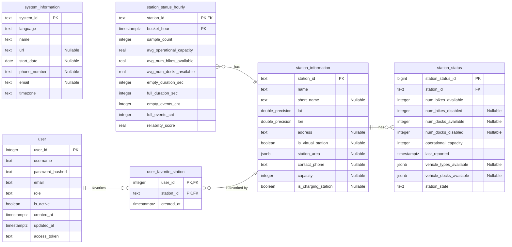

# ERD

La table SystemInformation n'est reliée à aucune autre table car :

- Métadonnées globales (singleton) : Cette table stocke des informations générales décrivant le réseau dans son ensemble (nom du service, contacts, fuseau horaire, URL). Elle n'a vocation à contenir qu'un enregistrement unique représentant l'opérateur.
- Périmètre mono-réseau (absence de multi-tenant) : L'application étant dédiée à la gestion d'un unique réseau de vélos en libre-service, propager une clé étrangère system_id vers chaque station ou entité opérationnelle introduirait une redondance inutile dans le schéma relationnel.

