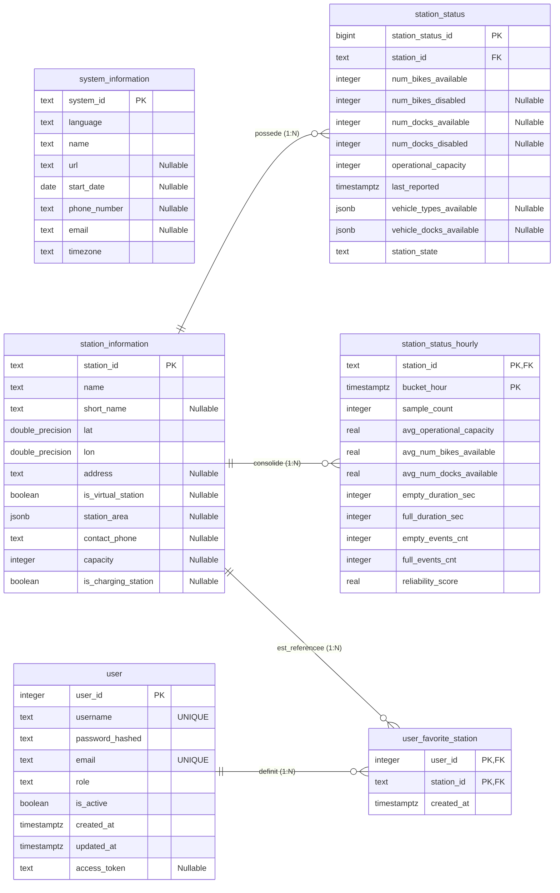

# ERD (Entity-Relationship Diagram)

## 1. Principes de conception et modélisation relationnelle

Le schéma physique de la base de données PostgreSQL de VeloScope a été modélisé pour concilier la conformité aux spécifications internationales de micromobilité (standard GBFS v2.3) avec une stratégie d'historisation et d'analyse temporelle performante.

### Isolation de `system_information` (Singleton)

La table `system_information` n'est reliée par aucune clé étrangère aux autres tables car :

- **Métadonnées globales (singleton)** : Cette table stocke des informations générales décrivant le réseau dans son ensemble (nom du service, contacts, fuseau horaire, URL). Elle n'a vocation à contenir qu'un enregistrement unique représentant l'opérateur.
- **Périmètre mono-réseau (absence de multi-tenant)** : L'application étant dédiée à la gestion d'un unique réseau de vélos en libre-service, propager une clé étrangère `system_id` vers chaque station introduirait une redondance inutile dans le schéma relationnel.

---

## 2. Diagramme Entité-Association (ERD)



---

## 3. Contraintes d'intégrité et stratégie d'indexation

### Intégrité relationnelle et cascades

- **Clés étrangères en cascade** : `station_status`, `station_status_hourly` et `user_favorite_station` référencent `station_information.station_id` avec la clause `ON DELETE CASCADE ON UPDATE CASCADE`. Toute modification d'identifiant ou suppression de station propage automatiquement l'intégrité sans laisser d'orphelins.
- **Clé primaire composite** : `user_favorite_station` associe `(user_id, station_id)` en tant que clé primaire composite, interdisant les doublons de favoris pour un même utilisateur.
- **Historique horaire composite** : `station_status_hourly` utilise la clé primaire composite `(station_id, bucket_hour)` pour garantir l'unicité de la tranche horaire par station.

### Indexation PostgreSQL pour requêtes haute fréquence

```sql
-- Unicité et recherche instantanée du dernier statut reçu
CREATE UNIQUE INDEX IF NOT EXISTS idx_station_status_station_reported 
    ON veloscope.station_status (station_id, last_reported);

-- Accélération des requêtes chronologiques d'historique (F3, F4)
CREATE INDEX IF NOT EXISTS idx_station_hourly_bucket 
    ON veloscope.station_status_hourly (bucket_hour DESC);

-- Calcul rapide du nombre de favoris par station
CREATE INDEX IF NOT EXISTS idx_fav_station 
    ON veloscope.user_favorite_station (station_id);

-- Résolution immédiate des sessions utilisateur par token
CREATE UNIQUE INDEX IF NOT EXISTS idx_user_access_token 
    ON veloscope."user" (access_token);
```

---

## 4. Évolutions du schéma suite aux retours d'analyse

1. **Simplification acceptée (suppression de tables superflues)** :
   - Dans le dossier d'analyse préliminaire, le modèle comportait des tables distinctes (`station_physical_capacity`, `station_virtual_capacity`, `vehicle_type`).
   - Suite à la remarque du tuteur sur un modèle potentiellement trop riche, ces tables ont été éliminées et consolidées directement dans `station_information` (`capacity`, `is_virtual_station`) et sous forme de structures PostgreSQL natives `JSONB` (`vehicle_types_available`, `vehicle_docks_available`), évitant des jointures coûteuses.
2. **Choix maintenu et défendu (partitionnement temporel et agrégats)** :
   - La table `station_status_hourly` est indispensable : à raison d'un relevé toutes les 5 minutes pour 100 à 200 stations, `station_status` accumule plus d'un million de lignes par mois. L'historique sur 7 ou 30 jours (F3) interroge directement les compartiments horaires pré-agrégés (168 lignes pour 7 jours) via l'index `(station_id, bucket_hour)`, garantissant un temps de réponse constant en quelques millisecondes sans saturer le serveur.
