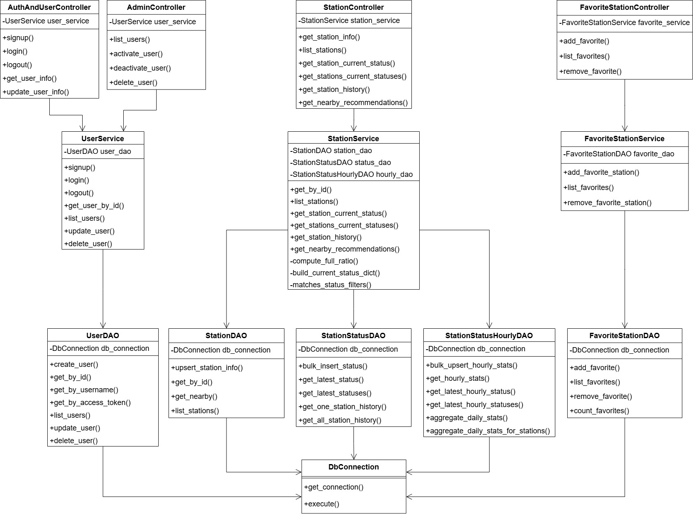

```{=typst}
#import "model.typ": project_template

#show: body => project_template(
  title: [Rapport de projet informatique\ \ VeloScope],
  team: [Équipe 30],
  authors: ([Martin DUBOS-DANIELLI], [Minh Quang KIEU], [Nathan LAIMANT], [Victor NEMBRINI], [Antonin PRADEL]),
  teacher: [Ludovic DENEUVILLE],
  tutor: [André RIVIÈRE],
  project: [Projet informatique de 2e année - Année 2026-2027],
  body
)

#show table: set text(size: 9pt)
#show table: set par(justify: false)
#show table: it => {
  show regex("[_/.]"): m => [#m#sym.zws]
  it
}
```

# **Contexte** {.unnumbered}

$\implies$ À reformuler

Les vélos en libre-service sont disponibles en temps réel dans de nombreuses villes. Pourtant, une simple carte des stations ne permet pas vraiment de répondre à des questions utiles : À quelle heure vais-je réellement trouver un vélo ? Quelles stations sont souvent pleines ? Quels trajets sont les plus fiables ? Est-ce qu’une station est régulièrement vide le matin mais pleine le soir ? Le projet VeloScope consiste à développer une API permettant de collecter, historiser et analyser les données de vélos en libre-service d’une ville. L’application récupère périodiquement les informations d’une API de vélos en libre-service compatible avec le standard GBFS : stations, nombre de vélos disponibles, nombre de places libres, vélos électriques, etc. Contrairement à une simple application de consultation, VeloScope construit son propre historique afin de permettre des analyses temporelles et de produire des indicateurs de fiabilité des stations. 



# **Présentation du projet**

## **Cahier des charges**

Le projet VeloScope consiste à développer une API permettant de collecter, historiser et analyser les données de vélos en libre-service d’une ville. L’application est utile à toute personne cherchant des informations sur des stations de vélos dans une ville. L’intérêt principal de l’application réside dans son analyse de la fiabilité des stations. Elle construit un score de fiabilité pour chaque station. Elle permet par ailleurs de visualiser ces informations pour chaque station afin d’éclairer le choix de l’utilisateur. Des fonctionnalités plus avancées sont disponibles pour les utilisateurs ayant créé un compte. 

$\implies$ mettre cahier des charges github

## **Organisation du travail**

### Organisation temporelle

$\implies$ Diagramme de Gantt 

Au début du projet, il était important pour nous de connaître l’ensemble des dates importantes pour savoir à quelle vitesse nous devions avancer dans notre projet. A partir de là, nous avons pu créer une liste asez générale des tâches à réaliser en nous imposant entre nous des dates à respecter. 

Le premier mois du projet était consacré à la modélisation du projet (nous avons très peu codé durant cette période). En effet, nous voulions privilégier une structure claire et solide sur laquelle notre code devait reposer, ce qui nous permettrait de gagner du temps plus tard. La modélisation était aussi le pilier du dossier d’analyse qui était à rendre mi-septembre, ce qui nous imposait arbitrairement une date limite pour réaliser notre modélisation.  

Ensuite, jusqu’à la rentrée des vacances de la Toussaint, nous nous sommes fixés pour objectif de coder le backend dans son ensemble. Pour gagner du temps, nous nous sommes répartis les tâches, et avons essayé de coder les tests le plus tôt que possible. Nous avons vérifié l’ensemble du fonctionnement du backend et des tests lors de la semaine de la rentrée. 

Le frontend était une partie importante de notre projet, donc nous avons cherché à y consacrer suffisamment de temps pour qu’il fonctionne au mieux. Nous y avons passé deux semaines (le code étant plus simple à implémenter que dans le backend). L’avantage d’avoir à coder le frontend est que cela nous a permis de repérer des erreurs dans notre backend que nous devions impérativement corriger.  

Le dernier rendu sur lequel nous nous sommes concentrés est le rapport final. Pour pouvoir avoir assez de temps pour l’écrire, donc nous nous sommes laissés deux semaines pour nous y consacrés entièrement, sans avoir à coder d’importantes fonctionnalités en même temps. 

### Répartition du travail

$\implies$ Pas de types de tâches assignées par défaut, tout le monde a touché à tout. 

La répartition du travail a davantage été présente au début de notre projet. En effet, nous avions divers diagrammes à réaliser, et nous nous les sommes répartis entre nous pour gagner du temps. Ainsi, les diagrammes nécessaires à l’avancée du projet : diagramme de Gantt, diagramme de cas d’utilisation, diagrammes d’activité et diagrammes de classes ont été réalisés dans les trois premières semaines (certains étant plus long à réaliser que d’autres). A partir de là, notre objectif était de préparer la structure de notre code (signature et documentation des fonction en grande partie) : deux d’entre nous y avons été consacré.  

Au départ, nous avions eu l’intention de pratiquer le “Test Driven Development”, c’est-à-dire que nous voulions d’abord coder les tests avant de coder l’intérieur de ces fonctions testées. Néanmoins, comme cela se révélait assez chronophage si une seule personne s’y consacrait (car cela impliquait de devoir comprendre toutes les fonctions testées et leur implémentation sans code encore écrit), nous avons finalement décidé de n’écrire uniquement les tests des fonctions que chacun de nous implémentait. 

L’ensemble des membres du groupe a codé dans chaque bloc (DAO, Services et Controller). Pour faciliter le passage au bloc supérieur, nous nous sommes répartis les différentes bases de données existantes à trois pour gagner du temps, et gagner en efficacité. Une personne s’est occupé des services externes (appels à l’API externe, calculs internes à réaliser dans les bases de données) et une autre avait commencé à modéliser le frontend après s’être occupé d’une DAO. L’idée de notre organisation était de faire en sorte que chaque membre du groupe se familiarise à tous les blocs pour gagner en expertise et pouvoir corriger plus facilement les erreurs que peuvent faire les autres. 

Dans le cas du frontend, nous n’avions pas d’organisation particulière. Certaines personnes se sont concentrées plus certaines pages que d’autres, et d’autres membres ont préféré s’assurer que l’ensemble du code fonctionne, qu’il n’y ait pas d’erreurs. C’est grâce à une communication efficace que nous avons réussi à ne pas interférer dans le travail des autres, ce qui aurait pu poser des problèmes au niveau du dépôt distant sur github. 

## **Outils de développement**



# **Modélisation UML**

## **Diagramme de cas d'utilisation**

$\implies$ Diagramme + explications dossier d’analyse 

ANTONIN 

## **Diagramme de packages**

## **Diagramme de classes**

Afin de concilier exhaustivité technique et lisibilité, la modélisation orientée objet de VeloScope est découpée en 3 diagrammes complémentaires : les **objets métier** (modèle de domaine pur), l'**architecture en couches du Web Service** (traitement des requêtes HTTP) et le **sous-système d'ingestion et d'agrégation** (collecte GBFS et calcul des indicateurs horaires en arrière-plan).

### Modèle de domaine et entités métier (*Business Objects*)

Les entités métier regroupées dans le module `business_object` constituent le socle sémantique de l'application. Ce sont des objets Python purs, totalement indépendants des bibliothèques d'infrastructure (FastAPI, Pydantic, PostgreSQL ou client HTTP).

{#fig-cd1 width=100%}

Ce modèle s'articule autour de six classes métier et deux énumérations : `SystemInformation` encapsule les métadonnées globales de l'opérateur, `StationInformation` représente le référentiel statique d'une station et `StationStatus` modélise un instantané de télémétrie haute fréquence caractérisé par l'énumération `StationState`. `StationStatusHourly` synthétise quant à elle les statistiques consolidées sur une tranche horaire (`bucket_hour`), incluant le score de fiabilité (`reliability_score`), tandis que `User` (associé à `UserRole`, statut logique, mot de passe haché et jeton de session) et `UserFavoriteStation` gèrent les comptes applicatifs et leurs stations favorites.

Le choix de distinguer `StationStatus` et `StationStatusHourly` dès le modèle de domaine répond à une contrainte de volumétrie : une collecte, toutes les 5 minutes, génère environ 288 relevés par jour et par station (soit plus d'un million d'enregistrements par mois à l'échelle d'un réseau urbain d'une centaine de stations). Isoler la télémétrie brute des agrégats horaires permet d'interroger efficacement les tendances sur 24 heures, 7 jours ou 30 jours sans recalcul coûteux.

### Architecture logicielle du Web Service

Le Web Service adopte une architecture en couches stricte et unidirectionnelle (**Contrôleurs $\rightarrow$ Services $\rightarrow$ DAO $\rightarrow$ Base de données**). Chaque couche occupe un niveau unique et bien délimité, sans appel transversal ni contournement de responsabilité :

{#fig-cd2 width=100%}

- **Couche Contrôleurs** : quatre routeurs FastAPI assurent exclusivement la réception des requêtes HTTP, la validation des schémas Pydantic, la vérification des droits d'accès via injection de dépendances et la traduction des retours métier en codes de statut HTTP.
- **Couche Services** : trois services centralisent la logique métier. `StationService` orchestre notamment la consultation, le calcul du taux de remplissage, l'assemblage des historiques multi-périodes et le moteur de recommandation à proximité.
- **Couche d'accès aux données** : cinq classes DAO encapsulent l'ensemble des requêtes SQL PostgreSQL et s'appuient sur l'objet `DbConnection` pour obtenir une connexion du pool. Plutôt que de regrouper toutes les requêtes liées aux stations dans un unique DAO monolithique, chaque table possède son propre DAO. Ce découpage respecte le principe de responsabilité unique en séparant des logiques SQL très distinctes. Il permet également d'injecter uniquement la dépendance nécessaire dans chaque composant, tout en facilitant les tests unitaires dédiés par table.

### Sous-système d'ingestion et d'agrégation en arrière-plan

Le troisième diagramme isole les composants exécutés en arrière-plan par le planificateur `APScheduler` pour alimenter la base de données et calculer les agrégats horaires :

{#fig-cd3 width=100%}

Ce sous-système repose sur `JobScheduler`, qui configure et cadence les tâches périodiques via `AsyncIOScheduler`, sur la classe abstraite générique `BaseIngestionStrategy[T]` déclinée en trois stratégies concrètes (`SystemInformationStrategy`, `StationInformationStrategy`, `StationStatusStrategy`), et sur `StationAggregator`, chargé de consolider périodiquement les statuts bruts en `StationStatusHourly`.

Il est important de souligner que ce sous-système ne constitue pas une seconde couche Service concurrente, mais un pipeline d'ETL (*Extract-Transform-Load*) exécuté en arrière-plan, découplé des requêtes HTTP et convergeant vers les mêmes classes DAO que le Web Service. Ce découplage par rapport à `StationService` repose sur les justifications architecturales majeures :

- **Séparation Service applicatif vs ETL, et réactivité utilisateur** : `StationService` doit répondre aux requêtes API en quelques dizaines de millisecondes à partir de PostgreSQL. Déclencher des appels réseau distants vers l'API GBFS externe au sein de `StationService` bloquerait les requêtes des utilisateurs.
- **Principe de responsabilité unique et patron Stratégie** : `StationService` se concentre sur l'interrogation et la recommandation, tandis que `BaseIngestionStrategy` isole la récupération HTTP, la normalisation de formats GBFS hétérogènes et l'insertion par lots. L'ajout d'un nouveau flux se fait par simple héritage sans modifier `StationService`.

## **Structure de la base de données et intégration du standard GBFS**

### Schéma relationnel et stratégie d'indexation

La base de données PostgreSQL est organisée au sein d'un schéma dédié `veloscope` composé de six tables, conçues pour garantir à la fois l'intégrité référentielle et la performance des requêtes temporelles :

{#fig-erd width=100%}

La table `system_information` stocke les métadonnées globales du réseau comme un singleton sans clé étrangère vers `station_information`, car VeloScope gère un réseau urbain configuré par instance (propager `system_id` introduirait une redondance inutile). Le cœur opérationnel associe le référentiel statique `station_information` à l'historique haute fréquence `station_status` ainsi qu'à la table de consolidation horaire `station_status_hourly`, identifiée par la clé primaire composite `(station_id, bucket_hour)` et regroupant moyennes, compteurs/durées critiques et `reliability_score`. Enfin, `user` (avec `username`, `email` et `access_token` `UNIQUE`) et la table d'association `N:N` `user_favorite_station`, munie de la clé primaire composite `(user_id, station_id)` interdisant les doublons, gèrent les comptes et leurs favoris.

Toutes les clés étrangères pointant vers `station_information` ou `user` portent les clauses `ON DELETE CASCADE ON UPDATE CASCADE` afin de préserver l'intégrité. Quatre index ciblés optimisent les chemins critiques : `idx_station_status_station_reported` (`UNIQUE` sur `(station_id, last_reported)`) garantit l'unicité des relevés en lot et accélère l'accès au dernier statut ; `idx_station_hourly_bucket` (`bucket_hour DESC`) accélère les requêtes chronologiques récentes ; `idx_fav_station` (`station_id`) optimise les requêtes inverses sur les favoris ; et `idx_user_access_token` (`UNIQUE` sur `access_token`) assure une résolution immédiate des jetons absents du cache mémoire.

### Sobriété du schéma et pertinence des critères GBFS retenus

Chaque attribut retenu depuis les flux du standard GBFS v2.3 répond à un besoin fonctionnel ou analytique précis. Dans `system_information.json`, les champs `name`, `timezone`, `language` et les coordonnées de contact (`url`, `phone_number`, `email`) fournissent le contexte du réseau et le fuseau horaire de référence. Dans `station_information.json`, `lat` et `lon` alimentent la géolocalisation cartographique et le calcul de distance de Haversine ; `name`, `short_name`, `address` et `capacity` supportent la recherche multicritère et la capacité nominale ; enfin, `is_virtual_station`, `station_area` et `contact_phone` assurent la compatibilité avec les stations hybrides/virtuelles prévues par GBFS v2.3.

Dans `station_status.json`, `num_bikes_available` et `num_docks_available` mesurent l'offre instantanée et permettent de déduire `operational_capacity = num_bikes_available + num_docks_available`, tandis que `last_reported` horodate chaque relevé pour l'historisation et le dédoublonnage. Les indicateurs booléens GBFS (`is_installed`, `is_renting`, `is_returning`) ne sont pas stockés tels quels afin d'éviter des colonnes redondantes, mais évalués dès l'ingestion pour synthétiser `station_state` (`EMPTY`, `FULL`, `FUNCTIONAL`), et `vehicle_types_available` est normalisé au format `{"mechanical": int, "electric": int}` afin de filtrer par motorisation indépendamment des identifiants opérateur.

Enfin, la coexistence des tables `station_status` et `station_status_hourly` constitue un partitionnement temporel applicatif indispensable : interroger directement `station_status` pour afficher une courbe sur 30 jours ou évaluer la fiabilité de dizaines de stations à proximité imposerait de parcourir des centaines de milliers de lignes à chaque appel API. Avec `station_status_hourly`, une requête sur 24 heures ne lit que 24 lignes par station et une requête sur 30 jours au plus 720 lignes (agrégées par jour côté SQL), assurant des temps de réponse constants.

## **Présentation de l'API**

L'API REST de VeloScope est développée avec **FastAPI** et exécutée sur **Uvicorn**, avec génération automatique des documentations OpenAPI (`/docs` et `/redoc`). Les entrées et sorties sont validées par **Pydantic** (journalisation globale des erreurs HTTP `422`), et la persistance repose sur **PostgreSQL** (`psycopg2` via le pool `DbConnection`). L'authentification utilise des jetons **HTTP Bearer** (préfixe `vls30_`), des mots de passe hachés en **SHA-256** et un cache mémoire *thread-safe* (`InMemTokenCache`) purgé à la déconnexion, désactivation ou suppression de compte. L'ensemble est complété par une journalisation HTTP (`LogMiddleware`), du linting/typage statique et une suite de tests isolée sur un schéma PostgreSQL dédié.

Le tableau ci-dessous synthétise les familles d'endpoints exposées (l'inventaire détaillé des 21 routes figure en [Annexe](#annexe-endpoints)) :

| Contrôleur | Préfixe / Routes principales | Accès | Rôle fonctionnel |
| :--- | :--- | :--- | :--- |
| `main` | `/`, `/hello/{name}`, `/db` | Public | Redirection Swagger, disponibilité et sonde PostgreSQL |
| `AuthAndUser` | `/signup`, `/login`, `/logout`, `/user/info` | Public / Bearer | Inscription, authentification, session et gestion du profil |
| `Admin` | `/admin/users` (+ `activate`, `deactivate`, `DELETE`) | Admin | Recherche paginée, activation, désactivation et suppression de comptes |
| `Station` | `/station` (+ `/{id}`, `/status`, `/statuses`, `/history`, `/recommendations`) | Public | Recherche multicritère, statuts temps réel/en lot, historique (`1h` à `30j`) et recommandations |
| `FavoriteStation` | `/favorites` (`GET`, `DELETE`) | Bearer | Ajout, consultation paginée et retrait de stations favorites |

: Synthèse des groupes d'endpoints de l'API REST VeloScope {tbl-colwidths="[16,30,14,40]"}

Trois choix structurent la conception de l'API :

- **Requêtes de recherche et de lot en `POST` (JSON)** : les filtres combinés et la récupération simultanée jusqu'à 500 statuts (`/station/statuses`) passent par des corps JSON validés par Pydantic, évitant la saturation des URL.
- **Cloisonnement sécuritaire** : `UserResponse` n'expose jamais `password_hashed` ; les dépendances `get_current_user` (HTTP `401`) et `get_current_admin` (HTTP `403`) séparent strictement les rôles, tout en empêchant un administrateur de modifier ou supprimer son propre compte (HTTP `400`).
- **Granularité adaptative de l'historique (`TimePeriod`)** : `/station/{station_id}/history` adapte la source selon `period` — relevés bruts (`1h`), agrégats horaires (`24h`) ou moyennes journalières (`7j`, `30j`).

# **Les fonctionnalités**

Les fonctionnalités principales de l’application sont les suivantes : 

- Création d’un compte / connexion 
- Recherche de stations en fonction d’un nom ou d’un identifiant 
- Accès aux informations sur les stations : score de fiabilité, adresse, capacité théorique, coordonnées GPS, ... 

Des fonctionnalités plus avancées sont disponibles pour les utilisateurs connectés : 

- Gestion du compte utilisateur (possibilité de changer les informations) 
- Proposition d’une station à proximité, selon la distance de l’utilisateur à cette station et le score de fiabilité de celle-ci 
- Gestion des stations favorites 

Les administrateurs ont la possibilité de gérer les comptes existants, notamment les supprimer si besoin. 

$\implies$ Pour chaque fonctionnalité, un diagramme d’activité + un peu d’explications. 

## **Authentification et gestion des informations utilisateur**

$\implies$ Diagramme à faire (création de compte, connexion, ...) : voir s'il est réellement à faire

L’authentification est l’une des premières fonctionnalités auxquelles un utilisateur a accès (c’est la raison pour laquelle, dans le frontend, ce sont les deux premières pages accessibles après la page d’accueil). Cela concerne trois actions différentes : l’inscription (la création d’un compte), la connexion à un compte et la gestion des informations après connexion. 

Lorsqu’un utilisateur n’a pas encore de compte, il peut en créer un : pour cela, il a besoin d’entrer un nom d’utilisateur, un email et un mot de passe. Le nom d’utilisateur ne peut pas correspondre à celui d’un utilisateur déjà existant (un message d’erreur s’affiche dans ce cas). Lorsque ces informations sont rentrées, l’utilisateur est automatiquement connecté à ce compte et peut utiliser les fonctionnalités propres à un utilisateur connecté, voire à celles d’un administrateur en fonction. 

Lorsque l’utilisateur possède déjà un compte et qu’il n’y est pas encore connecté, celui-ci peut le faire sur la page de connexion. Sur cette page, il faut entrer son nom d’utilisateur et son mot de passe pour pouvoir se connecter. Si l’une des deux informations est fausse, un message d’erreur s’affiche et un bouton pour accéder à la page d’inscription apparaît. Si les informations sont bonnes, l’utilisateur est connecté à son compte. 

Lorsqu’un utilisateur est connecté, il peut tout d’abord se déconnecter en allant sur la page d’accueil. Il peut aussi changer ses informations (nom d’utilisateur, email et mot de passe) dans la page « Mon profil ». En effet, sur cette page, l’utilisateur peut consulter ses informations et les modifier. Pour changer ces informations, il suffit juste d’entrer de nouvelles informations (différentes des originales) dans les zones de texte indiquées et correspondant à l’information à modifier. Lorsque du texte est entré, il suffit de recliquer sur la page dans la barre latérale pour voir la nouvelle information ainsi modifiée. 

## **Recherche et consultation de stations**

$\implies$ Diagramme à faire

## **Gestion des stations favorites**


Avoir liste de stations favorites est une fonctionnalité clé de toute application de transports en commun, dans notre cas, de stations de vélos urbains. Ainsi, nous avons dû assez rapidement réfléchir à son implémentation au sein de notre application VeloScope. Grâce à cette fonctionnalité, un utilisateur peut plus rapidement accéder à certaines stations en particulier. 

La première limite que nous avons posée pour pouvoir accéder à une liste de stations favorites est celle d’avoir à être connecté à un compte. En effet, au niveau de la base de données, pour qu’une station soit considérée comme préférée par un utilisateur, il pouvoir identifier ce dernier, le meilleur moyen disponible pour le faire étant la connexion à un compte. A partir de cela, nous modélisons la gestion des stations favorites par deux actions à réaliser : l’ajout ou la suppression d’une station à cette liste.  

Pour ajouter une station à la liste des favoris, il faut accéder au menu des informations de la station, dans lequel un bouton permet d’ajouter la station à la liste des favoris. Néanmoins, ce menu n’est pas accessible à partir de celui de la liste des favoris, ainsi, un bouton permettant d’accéder à la liste des stations et un autre au menu de recherche règlent ce problème. Lorsque la station que l’utilisateur veut ajouter est trouvée dans l’un de ces deux menus, celui-ci peut accéder aux informations de la station pour pouvoir l’ajouter aux favoris. 

Il est possible de suivre la même démarche pour supprimer une station de la liste des favoris, le bouton d’ajout étant un bouton de suppression si la station appartient à la liste. Toutefois, le bas de la page permet de choisir l’une des stations de la liste et d’immédiatement la supprimer. Ainsi, la station disparaît de la liste. 

## **Score de fiabilité** {#sec-score-fiabilite}

Le score de fiabilité (compris entre `0` et `100`) évalue la capacité d'une station à assurer durablement la mise à disposition et la restitution de vélos. Calculé chaque heure par `StationAggregator` sur la tranche UTC écoulée $[\text{start\_time}, \text{end\_time})$ (soit $T_{\text{total}} = 3600\text{ s}$), il est persisté dans `station_status_hourly.reliability_score`.

### Reconstitution des durées d'état

À partir des relevés chronologiques d'une station sur l'heure écoulée, `StationAggregator` calcule d'abord les moyennes de capacité et de disponibilité (`_compute_basic_averages`), puis reconstitue les durées d'indisponibilité par maintien d'état entre relevés consécutifs (`_compute_durations_and_events`) : le premier relevé couvre $[\text{start\_time}, t(s_1))$, chaque relevé intermédiaire $[t(s_i), t(s_{i+1}))$ et le dernier $[t(s_{n-1}), \text{end\_time})$ (un relevé unique couvre $T_{\text{total}}$). Les durées cumulées à l'état `EMPTY` (`empty_duration_sec`) et `FULL` (`full_duration_sec`) ainsi que le nombre de transitions vers ces états (`empty_events_cnt`, `full_events_cnt`) sont alors extraits avec garantie de cohérence (une durée non nulle implique au moins un épisode).

### Formulation mathématique du score

La méthode `_compute_reliability_score` combine le taux d'indisponibilité et la durée moyenne (en minutes) des épisodes critiques :

$$
P_{\text{empty}} = \frac{\text{empty\_duration\_sec}}{T_{\text{total}}} \times 100, \qquad
P_{\text{full}} = \frac{\text{full\_duration\_sec}}{T_{\text{total}}} \times 100
$$

$$
D_{\text{empty}} = \begin{cases}
\frac{\text{empty\_duration\_sec} / 60}{\text{empty\_events\_cnt}} & \text{si } \text{empty\_events\_cnt} > 0 \\
0 & \text{sinon}
\end{cases}, \qquad
D_{\text{full}} = \begin{cases}
\frac{\text{full\_duration\_sec} / 60}{\text{full\_events\_cnt}} & \text{si } \text{full\_events\_cnt} > 0 \\
0 & \text{sinon}
\end{cases}
$$

$$
\text{score} = \max\Big(0,\; 100 - \big(w_1 \cdot P_{\text{empty}} + w_2 \cdot P_{\text{full}} + w_3 \cdot \min(100,\; D_{\text{empty}} + D_{\text{full}})\big)\Big)
$$

avec $w_1 = 0{,}55$, $w_2 = 0{,}35$ et $w_3 = 0{,}10$ (arrondi à 2 décimales). La justification détaillée de ces pondérations (asymétrie pénurie/saturation, effet de persistance) ainsi que l'agrégation sur les fenêtres longues (7 et 30 jours) sont présentées en [Annexe](#annexe-fiabilite).

## **« Je veux un vélo à proximité » :** Recommendation de vélo à proximité d'un lieu donné


## **Administrateur :** gestion des comptes utilisateurs existants

$\implies$ Diagramme à faire

## **Maintien à jour de la base de données**

### Orchestration temporelle via `APScheduler`

Le maintien à jour de la base est piloté en arrière-plan par `JobScheduler`, démarré et arrêté automatiquement par le gestionnaire `lifespan` de FastAPI (`main.py`) en même temps que le client `httpx.AsyncClient` et le pool `DbConnection`. Il s'appuie sur `AsyncIOScheduler` et des déclencheurs `CronTrigger` alignés sur l'horloge système :

| Identifiant du job | Déclencheur (`CronTrigger`) | Exécution au démarrage | Composant appelé | Rôle |
| :--- | :--- | :--- | :--- | :--- |
| `job_system_information` | `minute=0` (1 fois / heure) | Oui | `SystemInformationStrategy.execute` | Mise à jour des métadonnées réseau |
| `job_station_information` | `minute=0` (1 fois / heure) | Oui | `StationInformationStrategy.execute` | Mise à jour du référentiel stations |
| `job_station_status` | `minute="*/5"` (toutes les 5 min) | Oui | `StationStatusStrategy.execute` | Collecte des statuts temps réel |
| `job_station_aggregation` | `minute=5` (1 fois / heure à `:05`) | Non | `StationAggregator.aggregate_hourly_stats` | Consolidation horaire et fiabilité |

: Planification des tâches de fond sous `APScheduler` {tbl-colwidths="[22,18,12,26,22]"}

### Pipeline d'ingestion, agrégation horaire et persistance idempotente

L'ingestion applique les patrons Méthode Template et Stratégie autour de `BaseIngestionStrategy[T]` : sa méthode `execute()` enchaîne `fetch_feed()`, `parse_payload()` et `persist()` dans un bloc `try/except` journalisé afin qu'une erreur réseau transitoire n'interrompe jamais le planificateur. Les URLs des trois flux GBFS étant externalisées dans `Settings` (`.env`), VeloScope peut basculer vers un autre réseau conforme à GBFS sans modifier le code. Lors du traitement des statuts, `StationStatusStrategy` absorbe les variations entre opérateurs (`snake_case`/`camelCase`, classification des véhicules en `{"mechanical": int, "electric": int}` par normalisation Unicode et expressions régulières), calcule `operational_capacity` et détermine `StationState` (`EMPTY` si la station est non installée, non louable, de capacité nulle ou sans vélo ; `FULL` si aucune borne n'est libre ou le retour impossible ; `FUNCTIONAL` sinon).

En complément de la collecte, la tâche `job_station_aggregation` déclenche `StationAggregator.aggregate_hourly_stats` chaque heure à la minute `:05` — un décalage garantissant que le relevé de `:00` est bien persisté avant consolidation. Le module extrait en une requête l'ensemble des statuts bruts de l'heure UTC écoulée $[H-1\text{h}00, H\text{h}00)$ via `StationStatusDAO.get_all_station_history`, calcule pour chaque station les moyennes de disponibilité, les durées/épisodes critiques et le score de fiabilité (détaillé en section [Score de fiabilité](#sec-score-fiabilite)), puis enregistre les objets `StationStatusHourly` en lot via `StationStatusHourlyDAO.bulk_upsert_hourly_stats`.

Enfin, les écritures en base sont conçues pour être performantes et idempotentes : `StationStatusDAO.bulk_insert_status` insère par lots de 1 000 lignes (`execute_values`) avec `ON CONFLICT (station_id, last_reported) DO NOTHING` pour ignorer tout doublon, tandis que `SystemInformationDAO.upsert_system_info`, `StationDAO.upsert_station_info` et `StationStatusHourlyDAO.bulk_upsert_hourly_stats` emploient `ON CONFLICT ... DO UPDATE` afin de mettre à jour le référentiel (système et stations) ou de rejouer une agrégation horaire sans effet de bord.

# **Structure du code**

```text
ensai-it-project-2a-team30/
├── backend/                  # REST API & background services
│   ├── src/
│   │   ├── business_object/  # Domain entities (User, StationStatus, etc.)
│   │   ├── controller/       # FastAPI endpoints & routers
│   │   ├── dao/              # PostgreSQL Data Access Objects
│   │   ├── dependencies/     # Dependency injection (DB, HTTP, Scheduler)
│   │   ├── schema/           # Pydantic request & response models
│   │   ├── service/          # Business logic, aggregations, recommendation
│   │   └── utils/            # DB connection pool, configuration & logging
│   ├── tests/                # Unit and integration tests (pytest)
│   └── README.md             # Developer documentation
├── frontend/                 # Interactive Streamlit application
│   ├── src/
│   │   ├── pages/            # Multi-page views (Search, Favorites, etc.)
│   │   └── utils/            # API client & session helpers
│   └── README.md             # Frontend guide
├── data/                     # Database creation & seed scripts
│   ├── init_db.sql           # Schema definition (veloscope)
│   ├── pop_db.sql            # Initial test dataset
│   ├── init_db_test.sql      # Isolated test schema (veloscope_test)
│   └── pop_db_test.sql       # Test dataset
└── README.md                 # User guide (this document)
```

# **Point intéressant à détaillé sur l'appli**

# **Guide d'utilisation**

$\implies$ Mise en contexte d’un utilisateur qui navigue dans l’application. Screenshots + explications des étapes pour chaque menu. L’idée de RF_groupe_19 avec les couleurs est vraiment pas mal. 

ANTONIN



# **Conclusion** {.unnumbered}



# **Annexes** {.unnumbered}

## **Bilan de groupe** {.unnumbered}

### Difficultés rencontrées {.unnumbered}

Les difficultés que nous avons pu rencontrer n’ont jamais été très importantes. Nous avons tout de même fait face à de petits contretemps tout au long du projet. 

La répartition du travail a parfois été inégale. Comme les tâches sont très dépendantes les unes des autres, il a parfois été difficile de ne pas donner plus de travail à un membre qu'à un autre. Par exemple, lorsque l'un de nous avait plus avancé sur la compréhension d'un problème ou d'une partie du sujet, il était facile de lui léguer le travail que cela engendrait par la suite. Ceci a pu provoquer des différences de charge de travail à certains moments du projet. 

La compréhension du sujet n'a pas été constamment aisée non plus. Comme aucun de nous n'avions travaillé sur des données de norme GBFS auparavant, nous n'étions pas familiarisés avec le sujet dès le début. Il nous a parfois fallu prendre du temps pour comprendre les particularités de la structure de la base de données. Par exemple, au commencement du projet, nous avons dû cerner la différence entre la capacité virtuelle d'une station et sa capacité physique. Nous avons réfléchi davantage à la manière de prendre en compte cette différence dans notre application. 

Enfin, tout au long du projet, nous avons naturellement fait face à des erreurs dans notre code (tests, liens frontend/backend, dépendances, etc). Ces problèmes ont été réglés rapidement la plupart du temps, et réfléchir à plusieurs sur leur résolution nous a permis de tous comprendre le code plus profondément. 

### Points forts et points à améliorer pour de futurs projets {.unnumbered}

Les points forts de notre équipe ont été multiples et nous ont permis d'avancer efficacement dans le projet. 

La communication a été de mise : nous avons naturellement créé un groupe WhatsApp entre nous pour nous communiquer régulièrement nos avancées et les problèmes rencontrés. Cela nous permettait d'échanger à distance quand il le fallait, par exemple au moment des différentes échéances ou encore quand un retour par mail nous était fait par le tuteur. 

Nous avons tenu à nous voir en présentiel assez souvent, avec une réunion par semaine durant la première phase du projet (en plus des cours avec le tuteur les vendredis). Cela a permis d'être sûrs que tout le monde était investi et motivé dans le projet, et de ne pas perdre cette motivation dans le temps. 

Concernant notre gestion de l'application, les conflits git ont été très rares. Chacun de nous a veillé à toujours récupérer le travail des autres avant de faire ses modifications. De plus, notre répartition du travail a permis de ne jamais avoir deux membres qui travaillaient sur le même fichier en même temps. 

Enfin, nous sommes satisfaits de la façon dont nous sommes "rentrés" dans le sujet au début du projet. Nous avons tous su comprendre rapidement les enjeux de celui-ci et les différents besoins auxquels répond l'application. 

$\implies$ Points à améliorer 

## Calcul de la proximité des stations {.unnumbered}

Dans l’API externe, chaque station a des coordonnées géographiques qui lui sont associées. Avec cela, nous avons accès à la latitude et à la longitude de chaque station. C’est notre cinquième fonctionnalité, « Je veux un vélo à proximité », qui en fait usage (des fonctionnalités optionnelles aussi mais nous ne les avons pas implémenté). Pour pouvoir faire des calculs de distance à partir d’un rayon donné, il nous a fallu utiliser une formule pour utiliser des coordonnées et ainsi obtenir une distance. C’est pour cela que nous avons fait le choix de la **formule de Haversine**. À partir de deux points dont nous avons les coordonnées géographiques en radians, nous pouvons calculer la distance qui les sépare en kilomètres. La latitude et la longitude étant donnés en degrés, il a aussi fallu convertir ces deux mesures en radians en les multipliant par $\frac{\pi}{180}$.

Avec : 

- $\textrm{hav}$ : la fonction haversine 
- $\theta$ : angle en radians quelconque 
- $d$ est la distance du grand cercle entre les deux points 
- $r$ est le rayon de la sphère, 
- $\phi_1,\phi_2$: latitude du point 1 et latitude du point 2, en radians 
- $\lambda_1,\lambda_2$: longitude du point 1 et longitude du point 2, en radians 
$$\textrm{hav}(\theta)=\sin^2\left(\frac{\theta}{2}\right)=\frac{1-\cos(\theta)}{2}$$ 
$$\textrm{hav}\left(\frac{d}{r}\right)=\textrm{hav}(\phi_2-\phi_1)+\cos(\phi_1)\cos(\phi_2)\textrm{hav}(\lambda_2-\lambda_1)$$ 
$$\iff d=2r\arcsin\left(\sqrt{\sin^2\left(\frac{\phi_2-\phi_1}{2}\right)+\cos(\phi_1)\cos(\phi_2)\sin^2\left(\frac{\lambda_2-\lambda_1}{2}\right)}\right)$$

Cette formule est implémentée deux fois dans l’application : 

- **Dans la chouche DAO**, à partir de coordonnées fixes (les arguments de la méthode en question), nous pouvons calculer la distance qui sépare ce point fixé de chaque station. Si la distance évaluée est inférieure au rayon donné, la station est choisie 
- **Dans la couche Service**, la fonction `haversine` du package du même nom calcule le rayon à prendre en compte pour choisir la station entre un point donné dans les arguments de la méthode en question et chaque station. La distance calculée est ensuite affichée dans le frontend. 

## Inventaire complet des endpoints de l'API REST {#annexe-endpoints .unnumbered}

| Méthode & Route | Contrôleur | Accès | Schéma Entrée / Sortie | Rôle fonctionnel |
| :--- | :--- | :--- | :--- | :--- |
| `GET /` | `main` | Public | Redirection $\rightarrow$ `/docs` | Accès direct à Swagger UI |
| `GET /hello/{name}` | `main` | Public | `str` $\rightarrow$ `dict` | Test minimal de disponibilité |
| `GET /db` | `main` | Public | — $\rightarrow$ `dict` (200 / 503) | Sonde de connectivité PostgreSQL |
| `POST /signup` | `AuthAndUser` | Public | `SignupRequest` $\rightarrow$ `MessageResponse` | Création de compte utilisateur |
| `POST /login` | `AuthAndUser` | Public | `LoginRequest` $\rightarrow$ `LoginResponse` | Authentification et émission de jeton |
| `POST /logout` | `AuthAndUser` | Bearer | — $\rightarrow$ `MessageResponse` | Invalidation du jeton en base et cache |
| `GET /user/info` | `AuthAndUser` | Bearer | — $\rightarrow$ `UserResponse` | Consultation du profil connecté |
| `PUT /user/info` | `AuthAndUser` | Bearer | `UserUpdateRequest` $\rightarrow$ `MessageResponse` | Modification du profil connecté |
| `POST /admin/users` | `Admin` | Admin | `UserSearchRequest` $\rightarrow$ `list[UserResponse]` | Recherche paginée des comptes |
| `POST /admin/users/activate/{user_id}` | `Admin` | Admin | `int` $\rightarrow$ `MessageResponse` | Réactivation d'un compte tiers |
| `POST /admin/users/deactivate/{user_id}` | `Admin` | Admin | `int` $\rightarrow$ `MessageResponse` | Désactivation et révocation de session |
| `DELETE /admin/users/{user_id}` | `Admin` | Admin | `int` $\rightarrow$ `MessageResponse` | Suppression définitive d'un compte |
| `GET /station/{station_id}` | `Station` | Public | `str` $\rightarrow$ `StationInfoResponse` | Fiche descriptive d'une station |
| `POST /station` | `Station` | Public | `StationSearchRequest` $\rightarrow$ `list[StationInfoResponse]` | Recherche multicritère paginée |
| `GET /station/{station_id}/status` | `Station` | Public | `str` $\rightarrow$ `StationStatusResponse` | État temps réel et dernier score |
| `POST /station/statuses` | `Station` | Public | `list[str]` ($\le 500$) $\rightarrow$ `dict[str, StationStatusResponse]` | Statuts temps réel en lot pour la carte |
| `GET /station/{station_id}/history` | `Station` | Public | `period` (`1h`/`24h`/`7j`/`30j`) $\rightarrow$ `list[StationStatusResponse]` | Historique multi-échelles et métriques |
| `POST /station/recommendations` | `Station` | Public | `StationRecommendationRequest` $\rightarrow$ `list[StationRecommendationResponse]` | Recommandation de proximité filtrée |
| `GET /favorites/{station_id}` | `FavoriteStation` | Bearer | `str` $\rightarrow$ `MessageResponse` | Ajout d'une station aux favoris |
| `GET /favorites/` | `FavoriteStation` | Bearer | `page`, `size` $\rightarrow$ `list[StationInfoResponse]` | Liste paginée des favoris |
| `DELETE /favorites/{station_id}` | `FavoriteStation` | Bearer | `str` $\rightarrow$ `MessageResponse` | Retrait d'une station des favoris |

: Inventaire des endpoints de l'API REST VeloScope {tbl-colwidths="[25,16,8,27,24]"}

## Justification des pondérations du score de fiabilité {#annexe-fiabilite .unnumbered}

- **Asymétrie entre pénurie et saturation ($w_1 = 0{,}55 > w_2 = 0{,}35$)** : une station vide (ou hors service / non louable, également classée `EMPTY` à l'ingestion) empêche tout usager de démarrer un trajet et pénalise donc plus sévèrement la fiabilité qu'une station pleine, qui n'affecte que le dépôt de fin de trajet.
- **Prise en compte de la persistance ($w_3 = 0{,}10$)** : le terme $\min(100, D_{\text{empty}} + D_{\text{full}})$ distingue des micro-ruptures rapidement corrigées d'une indisponibilité prolongée. Par exemple, pour 20 minutes passées à l'état vide sur une heure ($P_{\text{empty}} = 33{,}33$, $P_{\text{full}} = 0$), un épisode unique continu de 20 minutes ($D_{\text{empty}} = 20$) aboutit à un score de $79{,}67$, contre $81{,}17$ si ces 20 minutes se répartissent en 4 courts épisodes de 5 minutes ($D_{\text{empty}} = 5$). Le plafonnement à $100$ minutes évite qu'un épisode unique ne domine excessivement la pénalité proportionnelle.
- **Agrégation sur les périodes longues** : pour les consultations d'historique sur 7 jours et 30 jours ainsi que pour l'indicateur `last_day_reliability` des recommandations, `StationStatusHourlyDAO.aggregate_daily_stats` et `aggregate_daily_stats_for_stations` calculent la moyenne journalière des scores horaires persistés.


