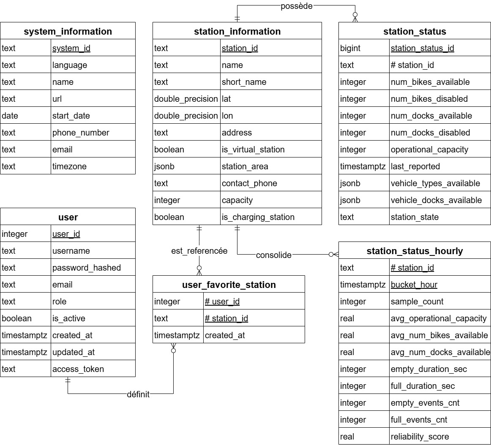
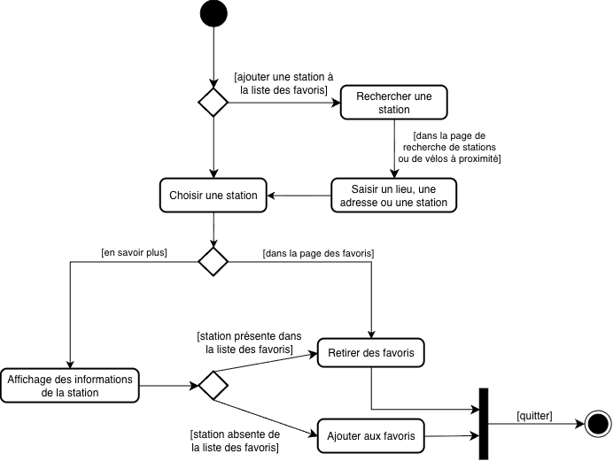

```{=typst}
#import "model.typ": project_template

#show: body => project_template(
  title: [Rapport de projet informatique\ \ VeloScope],
  team: [Équipe 30],
  authors: ([Martin DUBOS-DANIELLI], [Minh Quang KIEU], [Nathan LAIMANT], [Victor NEMBRINI], [Antonin PRADEL]),
  teacher: [Ludovic DENEUVILLE],
  tutor: [André RIVIÈRE],
  project: [Projet informatique de 2e année - Année 2026-2027],
  body
)
```

# **Contexte** {.unnumbered}

$\implies$ À reformuler

Les vélos en libre-service sont disponibles en temps réel dans de nombreuses villes. Pourtant, une simple carte des stations ne permet pas vraiment de répondre à des questions utiles : À quelle heure vais-je réellement trouver un vélo ? Quelles stations sont souvent pleines ? Quels trajets sont les plus fiables ? Est-ce qu’une station est régulièrement vide le matin mais pleine le soir ? Le projet VeloScope consiste à développer une API permettant de collecter, historiser et analyser les données de vélos en libre-service d’une ville. L’application récupère périodiquement les informations d’une API de vélos en libre-service compatible avec le standard GBFS : stations, nombre de vélos disponibles, nombre de places libres, vélos électriques, etc. Contrairement à une simple application de consultation, VeloScope construit son propre historique afin de permettre des analyses temporelles et de produire des indicateurs de fiabilité des stations. 



# **Présentation du projet**

## **Cahier des charges**

Le projet VeloScope consiste à développer une API permettant de collecter, historiser et analyser les données de vélos en libre-service d’une ville. L’application est utile à toute personne cherchant des informations sur des stations de vélos dans une ville. L’intérêt principal de l’application réside dans son analyse de la fiabilité des stations. Elle construit un score de fiabilité pour chaque station. Elle permet par ailleurs de visualiser ces informations pour chaque station afin d’éclairer le choix de l’utilisateur. Des fonctionnalités plus avancées sont disponibles pour les utilisateurs ayant créé un compte. 

$\implies$ mettre cahier des charges github

## **Organisation du travail**

### Organisation temporelle

$\implies$ Diagramme de Gantt 

Au début du projet, il était important pour nous de connaître l’ensemble des dates importantes pour savoir à quelle vitesse nous devions avancer dans notre projet. A partir de là, nous avons pu créer une liste asez générale des tâches à réaliser en nous imposant entre nous des dates à respecter. 

Le premier mois du projet était consacré à la modélisation du projet (nous avons très peu codé durant cette période). En effet, nous voulions privilégier une structure claire et solide sur laquelle notre code devait reposer, ce qui nous permettrait de gagner du temps plus tard. La modélisation était aussi le pilier du dossier d’analyse qui était à rendre mi-septembre, ce qui nous imposait arbitrairement une date limite pour réaliser notre modélisation.  

Ensuite, jusqu’à la rentrée des vacances de la Toussaint, nous nous sommes fixés pour objectif de coder le backend dans son ensemble. Pour gagner du temps, nous nous sommes répartis les tâches, et avons essayé de coder les tests le plus tôt que possible. Nous avons vérifié l’ensemble du fonctionnement du backend et des tests lors de la semaine de la rentrée. 

Le frontend était une partie importante de notre projet, donc nous avons cherché à y consacrer suffisamment de temps pour qu’il fonctionne au mieux. Nous y avons passé deux semaines (le code étant plus simple à implémenter que dans le backend). L’avantage d’avoir à coder le frontend est que cela nous a permis de repérer des erreurs dans notre backend que nous devions impérativement corriger.  

Le dernier rendu sur lequel nous nous sommes concentrés est le rapport final. Pour pouvoir avoir assez de temps pour l’écrire, donc nous nous sommes laissés deux semaines pour nous y consacrés entièrement, sans avoir à coder d’importantes fonctionnalités en même temps. 

### Répartition du travail

$\implies$ Pas de types de tâches assignées par défaut, tout le monde a touché à tout. 

La répartition du travail a davantage été présente au début de notre projet. En effet, nous avions divers diagrammes à réaliser, et nous nous les sommes répartis entre nous pour gagner du temps. Ainsi, les diagrammes nécessaires à l’avancée du projet : diagramme de Gantt, diagramme de cas d’utilisation, diagrammes d’activité et diagrammes de classes ont été réalisés dans les trois premières semaines (certains étant plus long à réaliser que d’autres). A partir de là, notre objectif était de préparer la structure de notre code (signature et documentation des fonction en grande partie) : deux d’entre nous y avons été consacré.  

Au départ, nous avions eu l’intention de pratiquer le “Test Driven Development”, c’est-à-dire que nous voulions d’abord coder les tests avant de coder l’intérieur de ces fonctions testées. Néanmoins, comme cela se révélait assez chronophage si une seule personne s’y consacrait (car cela impliquait de devoir comprendre toutes les fonctions testées et leur implémentation sans code encore écrit), nous avons finalement décidé de n’écrire uniquement les tests des fonctions que chacun de nous implémentait. 

L’ensemble des membres du groupe a codé dans chaque bloc (DAO, Services et Controller). Pour faciliter le passage au bloc supérieur, nous nous sommes répartis les différentes bases de données existantes à trois pour gagner du temps, et gagner en efficacité. Une personne s’est occupé des services externes (appels à l’API externe, calculs internes à réaliser dans les bases de données) et une autre avait commencé à modéliser le frontend après s’être occupé d’une DAO. L’idée de notre organisation était de faire en sorte que chaque membre du groupe se familiarise à tous les blocs pour gagner en expertise et pouvoir corriger plus facilement les erreurs que peuvent faire les autres. 

Dans le cas du frontend, nous n’avions pas d’organisation particulière. Certaines personnes se sont concentrées plus certaines pages que d’autres, et d’autres membres ont préféré s’assurer que l’ensemble du code fonctionne, qu’il n’y ait pas d’erreurs. C’est grâce à une communication efficace que nous avons réussi à ne pas interférer dans le travail des autres, ce qui aurait pu poser des problèmes au niveau du dépôt distant sur github. 

## **Outils de développement**



# **Modélisation UML**

## **Diagramme de cas d'utilisation**

$\implies$ Diagramme + explications dossier d’analyse 

ANTONIN 

## **Diagramme de packages**

## **Diagramme de classes**

## **Présentation de l'API externe**

## **Structure de la base de données**

## **Architecture globale** (?)

### Principes directeurs et programmation en couches

Pour répondre aux exigences de robustesse, de maintenabilité et d'évolutivité d'une application de collecte, d'historisation et d'analyse en temps réel, nous avons adopté une architecture logicielle en couches, articulée autour des principes de forte cohésion et de faible couplage (*Separation of Concerns*). 

Dans cette organisation, chaque couche logicielle se voit assigner une responsabilité métier strictement délimitée, et les dépendances sont strictement descendantes :

1. **Couche Présentation (Contrôleurs / Routeurs FastAPI)** : Point d'entrée de l'API web RESTful. Elle gère la réception des requêtes HTTP, la validation formelle des paramètres via les schémas Pydantic, la sérialisation des réponses et le contrôle des autorisations (authentification sécurisée par Bearer token). Elle délègue immédiatement tout traitement métier à la couche service sous-jacente.
2. **Couche Métier / Applicative (Services)** : Cœur décisionnel de l'application. Elle implémente la logique applicative (authentification, hachage des mots de passe par `bcrypt`, calcul des ratios d'occupation, algorithme de recommandation multicritère, calcul géodésique de distance). Cette couche est totalement agnostique vis-à-vis du protocole de transport (HTTP) et du système de gestion de base de données (PostgreSQL).
3. **Couche Accès aux Données (DAO - Data Access Objects)** : Abstraction de la persistance relationnelle. Chaque classe DAO encapsule la totalité des requêtes SQL (écrites en SQL brut optimisé via le pilote `psycopg2`), gère la transactionnalité, et convertit les tuples retournés par le SGBD en objets métier ou réciproquement.
4. **Couche Modèle Domaine (Entités métier / Business Objects)** : Objets purs modélisant le domaine d'affaires (stations, statuts instantanés, utilisateurs, agrégats horaires). Ces classes traversent toutes les couches sans dépendre d'aucun composant applicatif ou d'infrastructure.

Par ailleurs, l'application intègre un **sous-système de traitement asynchrone d'arrière-plan** orchestré par `APScheduler` (`JobScheduler`). Ce sous-système cadence l'ingestion des flux GBFS distants et le calcul par lots (*batch*) des agrégations statistiques et du score de fiabilité, tout en convergeant vers les mêmes classes de persistance (DAO).



### Modèle de données

Le modèle relationnel de VeloScope a été pensé pour allier la rigueur du standard GBFS (v2.*) avec une stratégie d'historisation à haute performance sous PostgreSQL.

{width=100%}

#### Structuration du schéma et intégrité relationnelle

Le schéma physique de la base de données PostgreSQL applique des contraintes d'intégrité relationnelle rigoureuses :

- **Clés primaires et étrangères avec cascade** : Les tables dépendantes (`station_status`, `station_status_hourly`, `user_favorite_station`) référencent la clé primaire `station_id` de `station_information` avec une clause `ON DELETE CASCADE ON UPDATE CASCADE`. Ainsi, toute évolution d'un identifiant ou suppression d'une station préserve automatiquement la consistance relationnelle de la base sans laisser d'enregistrements orphelins. La table de jointure `user_favorite_station` associe une clé primaire composite `(user_id, station_id)`.
- **Stratégie d'indexation pour requêtes haute fréquence** :
  - `idx_station_status_station_reported` : index unique composite sur `(station_id, last_reported)` garantissant à la fois l'idempotence des insertions lors de l'ingestion temps réel et l'extraction instantanée du dernier statut.
  - `idx_station_hourly_bucket` : index sur `bucket_hour DESC` permettant d'optimiser les requêtes chronologiques d'historique.
  <!-- - `idx_fav_station` : index sur `station_id` dans `user_favorite_station` pour calculer rapidement le nombre d'utilisateurs ayant mis en favori chaque station (`count_favorites`). -->
  - `idx_user_access_token` : index unique sur `access_token` pour une résolution immédiate de la session utilisateur lors du passage dans les intercepteurs d'authentification.

#### Évolution du modèle de données suite aux retours intermédiaires

Suite aux remarques du tuteur lors de l’évaluation intermédiaire concernant un modèle de données jugé trop riche, nous avons épuré notre schéma relationnel pour ne conserver que les données essentielles au cœur analytique du projet :

1. **Simplification acceptée : suppression des tables intermédiaires superflues** :
   Nous avons éliminé quelques tables auxiliaires distinctes (`station_physical_capacity`, `station_virtual_capacity`, `vehicle_type`) pour éviter la surcharge de jointures relationnelles. La distinction physique/virtuelle a été intégrée directement sous forme d'attributs natifs dans `station_information` (`capacity`, `is_virtual_station`). De même, la ventilation par types de véhicules (vélos mécaniques vs vélos à assistance électrique) est stockée de manière compacte via le type PostgreSQL natif `JSONB` (`vehicle_types_available`, `vehicle_docks_available`). Cette modification a rendu le schéma beaucoup plus sobre et lisible, tout en conservant une conformité stricte avec les flux GBFS v2.3.
2. **Choix architectural maintenu et défendu : isolation de `system_information` en singleton** :
   La table `system_information` n'est rattachée par aucune clé étrangère aux stations. Comme VeloScope gère le réseau d'une agglomération donnée (mono-opérateur), dupliquer une clé `system_id` sur chaque station aurait constitué une redondance relationnelle artificielle sans valeur ajoutée. L'isoler dans une table singleton dédiée permet d'archiver la version du flux, le fuseau horaire et les coordonnées de l'opérateur sans alourdir le schéma opérationnel.



### Diagrammes de classes du système

Pour garantir une lisibilité optimale et répondre à la critique du dossier d'analyse sur la clarté de la modélisation logicielle, nous décomposons le diagramme de classes en trois diagrammes ciblés et hautement cohésifs :

1. Les classes du modèle domaine métier (Business Objects) ;
2. Les classes de l'architecture logicielle du Web Service (Contrôleurs, Services et DAOs) ;
3. Les classes du sous-système asynchrone d'ingestion et d'agrégation (Background Jobs).

#### Modèle de domaine et entités métier (Business Objects)

Les entités métier constituent le socle de l'application. Ce sont des objets purs, dépourvus de toute dépendance vers les bibliothèques d'infrastructure (FastAPI, SQL, HTTP).

{width=100%}

**Justification de la modélisation métier :**

Face aux interrogations sur la richesse du modèle métier, nous défendons la stricte nécessité de chacun des composants retenus :

1. **Partitionnement temporel entre télémétrie brute (`StationStatus`) et consolidations (`StationStatusHourly`)** :
   La table `station_status` enregistre un instantané toutes les 5 minutes. Pour un réseau d'une centaine de stations, cela engendre environ 28 800 lignes par jour, soit près d'un million d'enregistrements par mois. Si les requêtes de consultation de l'historique sur 7 jours ou 30 jours devaient balayer et agréger ces millions de lignes brutes à la volée, les temps de réponse de l'API atteindraient plusieurs secondes en provoquant des lectures de table massives (*full table scans*), saturant le serveur PostgreSQL.
   La création de `StationStatusHourly` résout ce problème à la racine : un traitement par lots calcule une seule fois par heure les moyennes, les durées de pénurie/saturation et le score de fiabilité. Pour restituer l'historique d'une station sur 7 jours, l'API ne lit plus que 168 lignes pré-calculées par simple parcours d'index `(station_id, bucket_hour)`.
2. **Nécessité fonctionnelle absolue des attributs conservés** :
   Aucun attribut conservé n'est inutile :
   - Les coordonnées géographiques (`lat`, `lon`) et la capacité opérationnelle permettent le calcul de la distance orthodromique par formule de \textrm{hav}ersine et du taux de disponibilité dans le moteur de recommandation multicritère.
   - Le champ `vehicle_types_available` (`{"mechanical": int, "electric": int}`) est indispensable pour appliquer le filtre de préférence utilisateur (rechercher spécifiquement un vélo électrique ou mécanique).
   - Les attributs temporels (`empty_duration_sec`, `full_duration_sec`, `empty_events_cnt`, `full_events_cnt`) sont les paramètres mathématiques d'entrée requis par la formule de fiabilité pour pondérer non seulement la durée de rupture de service, mais aussi la fréquence et la persistance des incidents.
3. **Sécurité et intégrité du modèle utilisateur** :
   L'entité `User` stocke l'empreinte chiffrée par `bcrypt` (`password_hashed`), l'état d'activité du compte (`is_active` permettant une désactivation logique sans casser l'historique des favoris), ainsi que l'énumération `UserRole` (`USER` vs `ADMIN`) assurant un contrôle d'accès strict sur les routes d'administration.

<!--  -->

#### Architecture logicielle du Web Service (Contrôleurs, Services et DAOs)

Le Web Service VeloScope regroupe l'ensemble des modules concourant au traitement synchrone des requêtes des utilisateurs et des administrateurs. 

Pour répondre directement à la remarque formulée sur le rapport d'analyse intermédiaire, le diagramme ci-dessous organise les classes selon une hiérarchie verticale stricte et unidirectionnelle, sans chevauchement de couches.

<!-- Diagramme de classes de l'architecture logicielle en couches du Web Service ici -->

##### Rationalisation de la couche service suite aux retours

Nous avons pleinement intégré la recommandation du tuteur à travers deux refactorisations majeures :

1. **Suppression de `RecommendationService` et `RecommendationController` au profit de `StationService`** :
   Dans le dossier d'analyse initial, la recommandation de vélos à proximité formait un couple Contrôleur/Service autonome. Or, ce service réclamait exactement les mêmes données que `StationService` (`StationDAO` pour la géolocalisation, `StationStatusDAO` pour l'état instantané, `StationStatusHourlyDAO` pour la fiabilité récente).
   La recommandation n'est pas une entité métier distincte, mais une requête spatiale filtrée sur les stations. Nous avons donc fusionné la méthode `get_nearby_recommendations` au sein de `StationService` et exposé la route correspondante (`POST /station/recommendations`) directement dans `StationController`. Cette rationalisation a réduit le nombre de services et de contrôleurs, ramenant l'architecture à 3 services centraux (`UserService`, `StationService`, `FavoriteStationService`).
2. **Élimination des micro-classes de calcul** :
   Notre modélisation d'origine comportait des classes d'aide atomiques sans état interne (`StationStateClassifier`, `StationCapacityCalculator`, `StationStateDurationCalculator`). Ces mécanismes ont été encapsulés sous forme de méthodes privées pures au sein de `StationService` et de calculs vectorisés dans l'agrégateur. Le diagramme de classes s'en trouve clarifié et allégé.

<!--  -->

#### Sous-système asynchrone d'ingestion et d'agrégation (Background Jobs)

La collecte des données externes et leur consolidation analytique constituent un sous-système autonome au sein de VeloScope. Cadencé par `APScheduler`, il s'exécute en tâche de fond indépendamment des requêtes web.

<!-- Diagramme de classes du sous-système d'ingestion et d'agrégation planifiée ici -->

##### Justification du découplage de l'ingestion par rapport aux services web

L'une des remarques les plus importantes de l'évaluation intermédiaire interrogeait ce découplage. Nous n'avons pas fusionné l'ingestion externe dans `StationService`. Ce choix de conception est délibéré et structurant par rapport aux arguments suivants :

1. **Découplage temporel et réactivité de l'expérience utilisateur** :
   `StationService` a pour mandat de servir les requêtes interactives des utilisateurs finaux (via Streamlit ou les clients HTTP). L'usager attend une réponse instantanée.
   Les appels réseau distants vers une API GBFS tierce sont tributaires de la latence Internet, du temps de traitement du serveur tiers et du transfert de volumineux payloads JSON. Si `StationService` interrogeait l'API externe à chaque requête de consultation, l'expérience utilisateur serait pénalisée par des temps d'attente imprévisibles. En interrogeant exclusivement la base locale PostgreSQL, l'API VeloScope garantit une latence minimale constante.
2. **Isolation des pannes et haute disponibilité** :
   Les serveurs publics de données de transport sont régulièrement sujets à des indisponibilités temporaires, des maintenances ou des coupures de réseau.
   Avec notre architecture découplée, si l'API GBFS distante subit une avarie, le service VeloScope reste opérationnel. Les utilisateurs continuent de consulter la carte des stations, de lire l'état le plus récent persisté en base, d'analyser les tendances historiques et de générer des recommandations. Si l'appel externe avait été intégré à `StationService`, toute panne du tiers aurait provoqué l'interruption immédiate de VeloScope pour tous les usagers.
3. **Principe de Responsabilité Unique (SRP)** :
   `StationService` est un service transactionnel (OLTP) orienté consultation et lecture pour les clients. Les stratégies d'ingestion et l'agrégateur constituent un pipeline d'ETL orienté écriture par lots. Mélanger ces deux responsabilités au sein d'une même classe aurait violé le principe de responsabilité unique (SRP) et engendré une classe excessivement complexe et difficile à tester unitairement.
4. **Extensibilité via le patron Stratégie** :
   L'ingestion repose sur une hiérarchie générique `BaseIngestionStrategy[T]` qui formalise le cycle de vie invariant (`fetch_feed()`, `parse_payload()`, `persist()`). L'intégration d'un nouveau flux GBFS (par exemple `system_pricing_plans`, `system_regions` ou la prise en charge d'un second réseau urbain) s'effectue par simple création d'une nouvelle sous-classe de stratégie, sans modifier ni risquer de déstabiliser `StationService` ou les contrôleurs existants (respect du principe Ouvert/Fermé).

# **Les fonctionnalités**

Les fonctionnalités principales de l’application sont les suivantes : 

- Création d’un compte / connexion 
- Recherche de stations en fonction d’un nom ou d’un identifiant 
- Accès aux informations sur les stations : score de fiabilité, adresse, capacité théorique, coordonnées GPS, ... 

Des fonctionnalités plus avancées sont disponibles pour les utilisateurs connectés : 

- Gestion du compte utilisateur (possibilité de changer les informations) 
- Proposition d’une station à proximité, selon la distance de l’utilisateur à cette station et le score de fiabilité de celle-ci 
- Gestion des stations favorites 

Les administrateurs ont la possibilité de gérer les comptes existants, notamment les supprimer si besoin. 

$\implies$ Pour chaque fonctionnalité, un diagramme d’activité + un peu d’explications. 

## **Authentification et gestion des informations utilisateur**

$\implies$ Diagramme à faire (création de compte, connexion, ...) : voir s'il est réellement à faire

L’authentification est l’une des premières fonctionnalités auxquelles un utilisateur a accès (c’est la raison pour laquelle, dans le frontend, ce sont les deux premières pages accessibles après la page d’accueil). Cela concerne trois actions différentes : l’inscription (la création d’un compte), la connexion à un compte et la gestion des informations après connexion. 

Lorsqu’un utilisateur n’a pas encore de compte, il peut en créer un : pour cela, il a besoin d’entrer un nom d’utilisateur, un email et un mot de passe. Le nom d’utilisateur ne peut pas correspondre à celui d’un utilisateur déjà existant (un message d’erreur s’affiche dans ce cas). Lorsque ces informations sont rentrées, l’utilisateur est automatiquement connecté à ce compte et peut utiliser les fonctionnalités propres à un utilisateur connecté, voire à celles d’un administrateur en fonction. 

Lorsque l’utilisateur possède déjà un compte et qu’il n’y est pas encore connecté, celui-ci peut le faire sur la page de connexion. Sur cette page, il faut entrer son nom d’utilisateur et son mot de passe pour pouvoir se connecter. Si l’une des deux informations est fausse, un message d’erreur s’affiche et un bouton pour accéder à la page d’inscription apparaît. Si les informations sont bonnes, l’utilisateur est connecté à son compte. 

Lorsqu’un utilisateur est connecté, il peut tout d’abord se déconnecter en allant sur la page d’accueil. Il peut aussi changer ses informations (nom d’utilisateur, email et mot de passe) dans la page « Mon profil ». En effet, sur cette page, l’utilisateur peut consulter ses informations et les modifier. Pour changer ces informations, il suffit juste d’entrer de nouvelles informations (différentes des originales) dans les zones de texte indiquées et correspondant à l’information à modifier. Lorsque du texte est entré, il suffit de recliquer sur la page dans la barre latérale pour voir la nouvelle information ainsi modifiée. 

## **Recherche et consultation de stations**

$\implies$ Diagramme à faire

## **Gestion des stations favorites**



Avoir liste de stations favorites est une fonctionnalité clé de toute application de transports en commun, dans notre cas, de stations de vélos urbains. Ainsi, nous avons dû assez rapidement réfléchir à son implémentation au sein de notre application VeloScope. Grâce à cette fonctionnalité, un utilisateur peut plus rapidement accéder à certaines stations en particulier. 

La première limite que nous avons posée pour pouvoir accéder à une liste de stations favorites est celle d’avoir à être connecté à un compte. En effet, au niveau de la base de données, pour qu’une station soit considérée comme préférée par un utilisateur, il pouvoir identifier ce dernier, le meilleur moyen disponible pour le faire étant la connexion à un compte. A partir de cela, nous modélisons la gestion des stations favorites par deux actions à réaliser : l’ajout ou la suppression d’une station à cette liste.  

Pour ajouter une station à la liste des favoris, il faut accéder au menu des informations de la station, dans lequel un bouton permet d’ajouter la station à la liste des favoris. Néanmoins, ce menu n’est pas accessible à partir de celui de la liste des favoris, ainsi, un bouton permettant d’accéder à la liste des stations et un autre au menu de recherche règlent ce problème. Lorsque la station que l’utilisateur veut ajouter est trouvée dans l’un de ces deux menus, celui-ci peut accéder aux informations de la station pour pouvoir l’ajouter aux favoris. 

Il est possible de suivre la même démarche pour supprimer une station de la liste des favoris, le bouton d’ajout étant un bouton de suppression si la station appartient à la liste. Toutefois, le bas de la page permet de choisir l’une des stations de la liste et d’immédiatement la supprimer. Ainsi, la station disparaît de la liste. 

## **Score de fiabilité**

$\implies$ Détail du score de fiabilité en fonction de la méthode dans `data_aggregation`.

## **« Je veux un vélo à proximité » :** Recommendation de vélo à proximité d'un lieu donné


## **Administrateur :** gestion des comptes utilisateurs existants

$\implies$ Diagramme à faire

## **Maintien à jour de la base de données**

$\implies$ explication du schedule (notamment `data_ingestion`)

# **Structure du code**

```text
ensai-it-project-2a-team30/
├── backend/                  # REST API & background services
│   ├── src/
│   │   ├── business_object/  # Domain entities (User, StationStatus, etc.)
│   │   ├── controller/       # FastAPI endpoints & routers
│   │   ├── dao/              # PostgreSQL Data Access Objects
│   │   ├── dependencies/     # Dependency injection (DB, HTTP, Scheduler)
│   │   ├── schema/           # Pydantic request & response models
│   │   ├── service/          # Business logic, aggregations, recommendation
│   │   └── utils/            # DB connection pool, configuration & logging
│   ├── tests/                # Unit and integration tests (pytest)
│   └── README.md             # Developer documentation
├── frontend/                 # Interactive Streamlit application
│   ├── src/
│   │   ├── pages/            # Multi-page views (Search, Favorites, etc.)
│   │   └── utils/            # API client & session helpers
│   └── README.md             # Frontend guide
├── data/                     # Database creation & seed scripts
│   ├── init_db.sql           # Schema definition (veloscope)
│   ├── pop_db.sql            # Initial test dataset
│   ├── init_db_test.sql      # Isolated test schema (veloscope_test)
│   └── pop_db_test.sql       # Test dataset
└── README.md                 # User guide (this document)
```

# **Point intéressant à détaillé sur l'appli**

# **Guide d'utilisation**

$\implies$ Mise en contexte d’un utilisateur qui navigue dans l’application. Screenshots + explications des étapes pour chaque menu. L’idée de RF_groupe_19 avec les couleurs est vraiment pas mal. 

ANTONIN



# **Conclusion** {.unnumbered}



# **Annexes** {.unnumbered}

## **Bilan de groupe** {.unnumbered}

### Difficultés rencontrées {.unnumbered}

Les difficultés que nous avons pu rencontrer n’ont jamais été très importantes. Nous avons tout de même fait face à de petits contretemps tout au long du projet. 

La répartition du travail a parfois été inégale. Comme les tâches sont très dépendantes les unes des autres, il a parfois été difficile de ne pas donner plus de travail à un membre qu'à un autre. Par exemple, lorsque l'un de nous avait plus avancé sur la compréhension d'un problème ou d'une partie du sujet, il était facile de lui léguer le travail que cela engendrait par la suite. Ceci a pu provoquer des différences de charge de travail à certains moments du projet. 

La compréhension du sujet n'a pas été constamment aisée non plus. Comme aucun de nous n'avions travaillé sur des données de norme GBFS auparavant, nous n'étions pas familiarisés avec le sujet dès le début. Il nous a parfois fallu prendre du temps pour comprendre les particularités de la structure de la base de données. Par exemple, au commencement du projet, nous avons dû cerner la différence entre la capacité virtuelle d'une station et sa capacité physique. Nous avons réfléchi davantage à la manière de prendre en compte cette différence dans notre application. 

Enfin, tout au long du projet, nous avons naturellement fait face à des erreurs dans notre code (tests, liens frontend/backend, dépendances, etc). Ces problèmes ont été réglés rapidement la plupart du temps, et réfléchir à plusieurs sur leur résolution nous a permis de tous comprendre le code plus profondément. 

### Points forts et points à améliorer pour de futurs projets {.unnumbered}

Les points forts de notre équipe ont été multiples et nous ont permis d'avancer efficacement dans le projet. 

La communication a été de mise : nous avons naturellement créé un groupe WhatsApp entre nous pour nous communiquer régulièrement nos avancées et les problèmes rencontrés. Cela nous permettait d'échanger à distance quand il le fallait, par exemple au moment des différentes échéances ou encore quand un retour par mail nous était fait par le tuteur. 

Nous avons tenu à nous voir en présentiel assez souvent, avec une réunion par semaine durant la première phase du projet (en plus des cours avec le tuteur les vendredis). Cela a permis d'être sûrs que tout le monde était investi et motivé dans le projet, et de ne pas perdre cette motivation dans le temps. 

Concernant notre gestion de l'application, les conflits git ont été très rares. Chacun de nous a veillé à toujours récupérer le travail des autres avant de faire ses modifications. De plus, notre répartition du travail a permis de ne jamais avoir deux membres qui travaillaient sur le même fichier en même temps. 

Enfin, nous sommes satisfaits de la façon dont nous sommes "rentrés" dans le sujet au début du projet. Nous avons tous su comprendre rapidement les enjeux de celui-ci et les différents besoins auxquels répond l'application. 

$\implies$ Points à améliorer 

## Calcul de la proximité des stations {.unnumbered}

Dans l’API externe, chaque station a des coordonnées géographiques qui lui sont associées. Avec cela, nous avons accès à la latitude et à la longitude de chaque station. C’est notre cinquième fonctionnalité, « Je veux un vélo à proximité », qui en fait usage (des fonctionnalités optionnelles aussi mais nous ne les avons pas implémenté). Pour pouvoir faire des calculs de distance à partir d’un rayon donné, il nous a fallu utiliser une formule pour utiliser des coordonnées et ainsi obtenir une distance. C’est pour cela que nous avons fait le choix de la **formule de Haversine**. À partir de deux points dont nous avons les coordonnées géographiques en radians, nous pouvons calculer la distance qui les sépare en kilomètres. La latitude et la longitude étant donnés en degrés, il a aussi fallu convertir ces deux mesures en radians en les multipliant par $\frac{\pi}{180}$.

Avec : 

- $\textrm{hav}$ : la fonction haversine 
- $\theta$ : angle en radians quelconque 
- $d$ est la distance du grand cercle entre les deux points 
- $r$ est le rayon de la sphère, 
- $\phi_1,\phi_2$: latitude du point 1 et latitude du point 2, en radians 
- $\lambda_1,\lambda_2$: longitude du point 1 et longitude du point 2, en radians 
$$\textrm{hav}(\theta)=\sin^2\left(\frac{\theta}{2}\right)=\frac{1-\cos(\theta)}{2}$$ 
$$\textrm{hav}\left(\frac{d}{r}\right)=\textrm{hav}(\phi_2-\phi_1)+\cos(\phi_1)\cos(\phi_2)\textrm{hav}(\lambda_2-\lambda_1)$$ 
$$\iff d=2r\arcsin\left(\sqrt{\sin^2\left(\frac{\phi_2-\phi_1}{2}\right)+\cos(\phi_1)\cos(\phi_2)\sin^2\left(\frac{\lambda_2-\lambda_1}{2}\right)}\right)$$

Cette formule est implémentée deux fois dans l’application : 

- **Dans la chouche DAO**, à partir de coordonnées fixes (les arguments de la méthode en question), nous pouvons calculer la distance qui sépare ce point fixé de chaque station. Si la distance évaluée est inférieure au rayon donné, la station est choisie 
- **Dans la couche Service**, la fonction `haversine` du package du même nom calcule le rayon à prendre en compte pour choisir la station entre un point donné dans les arguments de la méthode en question et chaque station. La distance calculée est ensuite affichée dans le frontend. 


