```{=typst}
#import "model.typ": project_template

#show: body => project_template(
  title: [Rapport de projet informatique\ \ VeloScope],
  team: [Équipe 30],
  authors: ([Martin DUBOS-DANIELLI], [Minh Quang KIEU], [Nathan LAIMANT], [Victor NEMBRINI], [Antonin PRADEL]),
  teacher: [Ludovic DENEUVILLE],
  tutor: [André RIVIÈRE],
  project: [Projet informatique de 2e année - Année 2026-2027],
  body
)

#show table: set text(size: 9pt)
#show table: set par(justify: false)
#show table: it => {
  show regex("[_/.]"): m => [#m#sym.zws]
  it
}
```

# **Contexte** {.unnumbered}

Les vélos en libre-service sont partout, visibles en temps réel sur une carte... et pourtant cette carte ne répond à aucune des vraies questions qu'on se pose. À quelle heure vais-je vraiment trouver un vélo ? Quelles stations sont systématiquement pleines à l'heure de pointe ? Quels trajets sont les plus fiables ? Une station se vide-t-elle chaque matin pour se remplir chaque soir ? Ce sont ces questions qui ont donné naissance à VeloScope. 

VeloScope est une API qui collecte, historise et analyse les données de vélos en libre-service d'une ville. Concrètement, l'application interroge périodiquement un flux de données compatible avec le standard GBFS — stations, vélos disponibles, places libres, vélos électriques, et bien d'autres informations. Mais là où une application de consultation classique se contente de données instantanées, VeloScope construit sa propre mémoire : un historique qui permet enfin des analyses temporelles et des indicateurs de fiabilité des stations, pour transformer ces données brutes en informations réellement utiles. 



# **Présentation du projet**

## **Cahier des charges**

Le projet VeloScope consiste à développer une API permettant de collecter, historiser et analyser les données de vélos en libre-service d’une ville. L’application est utile à toute personne cherchant des informations sur des stations de vélos dans une ville. L’intérêt principal de l’application réside dans son analyse de la fiabilité des stations. Elle construit un score de fiabilité pour chaque station basé sur leurs données intertemporelles. Elle permet par ailleurs de visualiser ces informations afin d’éclairer le choix de l’utilisateur. Des fonctionnalités plus avancées sont disponibles pour les utilisateurs possédant un compte sur Veloscope. 

Rappel du cahier des charges : 

- **F1 : Gestion des utilisateurs**. Un utilisateur peut : 
  + Créer un compte ; 
  + Se connecter ; 
  + Consulter les données et statistiques ; 
  + Gérer ses stations favorites ;
  + Un compte ADMIN peut gérer les utilisateurs. 
- **F2 : Collecte des données.** L’application doit interroger régulièrement l’API GBFS choisie et récupérer les informations des stations. Pour chaque relevé, on stockera notamment : 
  + Station ; 
  + Date et heure ; 
  + Nombre de vélos disponibles ; 
  + Nombre de places disponibles ; 
  + Nombre de vélos électriques ; 
  + État de la station : les données récupérées doivent être historisées en base PostgreSQL. L’application ne doit pas simplement remplacer les valeurs précédentes : elle doit permettre de reconstruire l’état du réseau à différents instants. 
- **F3 : Consultation d’une station.** L’utilisateur peut rechercher une station et consulter : 
  + Son état actuel ; 
  + Son nombre de vélos disponibles ; 
  + Sa capacité ; 
  + Son taux de remplissage ; 
  + L’évolution de sa disponibilité sur une période donnée. L’utilisateur doit notamment pouvoir choisir une période : 
    - Dernières 24 heures ; 
    - 7 derniers jours ; 
    - 30 derniers jours. 
- **F4 : Score de fiabilité des stations.** C’est la fonctionnalité métier principale. Pour chaque station, l’application calcule un score de fiabilité. Par exemple, une station est considérée comme : 
  + Vide lorsqu’il n’y a plus de vélo disponible ; 
  + Saturée lorsqu’il ne reste plus de place ; 
  + Fonctionnelle dans les autres cas. 
  + À partir de l’historique, l’application calcule notamment : 
    - Pourcentage du temps passé vide ; 
    - Pourcentage du temps passé saturé ; 
    - Durée moyenne des épisodes de saturation ; 
    - Durée moyenne des épisodes de pénurie ; 
    - Évolution du score au cours du temps. Le score global est défini par les étudiants à partir d’une formule documentée. 
- **F5 : Recommandation de station.** Lorsqu’un utilisateur demande : « Je veux prendre un vélo à proximité » l’API doit être capable de lui proposer plusieurs stations pertinentes. La recommandation doit prendre en compte plusieurs critères, par exemple : 
  + Distance ; 
  + Nombre de vélos actuellement disponibles ; 
  + Fiabilité historique de la station ; 
  + Disponibilité de vélos électriques ; 
  + Tendance récente de la station. Deux stations à distance équivalente ne doivent donc pas nécessairement être classées de la même manière. La formule de classement devra être justifiée et testée. 

## **Organisation du travail**

### Organisation temporelle

:::{#fig-gantt}
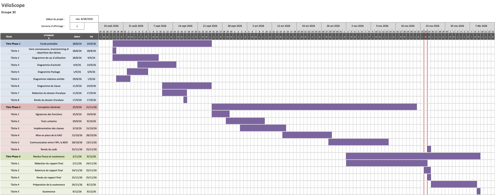 

Diagramme de Gantt
:::

Au début du projet, il était important pour nous de connaître l’ensemble des dates importantes pour savoir à quelle vitesse nous devions avancer dans notre projet. A partir de là, nous avons pu créer une liste asez générale des tâches à réaliser en nous imposant entre nous des dates à respecter. 

Le premier mois du projet était consacré à la modélisation du projet (nous avons très peu codé durant cette période). En effet, nous voulions privilégier une structure claire et solide sur laquelle notre code devait reposer, ce qui nous permettrait de gagner du temps plus tard. La modélisation était aussi le pilier du dossier d’analyse qui était à rendre mi-septembre, ce qui nous imposait arbitrairement une date limite pour réaliser notre modélisation.  

Ensuite, jusqu’à la rentrée des vacances de la Toussaint, nous nous sommes fixés pour objectif de coder le backend dans son ensemble. Pour gagner du temps, nous nous sommes répartis les tâches, et avons essayé de coder les tests le plus tôt que possible. Nous avons vérifié l’ensemble du fonctionnement du backend et des tests lors de la semaine de la rentrée. 

Le frontend était une partie importante de notre projet, donc nous avons cherché à y consacrer suffisamment de temps pour qu’il fonctionne au mieux. Nous y avons passé deux semaines (le code étant plus simple à implémenter que dans le backend). L’avantage d’avoir à coder le frontend est que cela nous a permis de repérer des erreurs dans notre backend que nous devions impérativement corriger.  

Le dernier rendu sur lequel nous nous sommes concentrés est le rapport final. Pour pouvoir avoir assez de temps pour l’écrire, donc nous nous sommes laissés deux semaines pour nous y consacrés entièrement, sans avoir à coder d’importantes fonctionnalités en même temps. 

### Répartition du travail

La répartition du travail a davantage été présente au début de notre projet. En effet, nous avions divers diagrammes à réaliser, et nous nous les sommes répartis entre nous pour gagner du temps. Ainsi, les diagrammes nécessaires à l’avancée du projet : diagramme de Gantt, diagramme de cas d’utilisation, diagrammes d’activité et diagrammes de classes ont été réalisés dans les trois premières semaines (certains étant plus long à réaliser que d’autres). A partir de là, notre objectif était de préparer la structure de notre code (signature et documentation des fonction en grande partie) : deux d’entre nous y avons été consacré.  

Au départ, nous avions eu l’intention de pratiquer le “Test Driven Development”, c’est-à-dire que nous voulions d’abord coder les tests avant de coder l’intérieur de ces fonctions testées. Néanmoins, comme cela se révélait assez chronophage si une seule personne s’y consacrait (car cela impliquait de devoir comprendre toutes les fonctions testées et leur implémentation sans code encore écrit), nous avons finalement décidé de n’écrire uniquement les tests des fonctions que chacun de nous implémentait. 

L’ensemble des membres du groupe a codé dans chaque bloc (DAO, Services et Controller). Pour faciliter le passage au bloc supérieur, nous nous sommes répartis les différentes bases de données existantes à trois pour gagner du temps, et gagner en efficacité. Une personne s’est occupé des services externes (appels à l’API externe, calculs internes à réaliser dans les bases de données) et une autre avait commencé à modéliser le frontend après s’être occupé d’une DAO. L’idée de notre organisation était de faire en sorte que chaque membre du groupe se familiarise à tous les blocs pour gagner en expertise et pouvoir corriger plus facilement les erreurs que peuvent faire les autres. 

Dans le cas du frontend, nous n’avions pas d’organisation particulière. Certaines personnes se sont concentrées plus certaines pages que d’autres, et d’autres membres ont préféré s’assurer que l’ensemble du code fonctionne, qu’il n’y ait pas d’erreurs. C’est grâce à une communication efficace que nous avons réussi à ne pas interférer dans le travail des autres, ce qui aurait pu poser des problèmes au niveau du dépôt distant sur github. 

## **Outils de développement**

L’application a été développée sous Python et la base de données est gérée via des services PostgreSQL. La majorité des membres du groupe a utilisé VSCode en local pour coder. Nous avons veillé à documenter l'ensemble de notre code, frontend et backend. La partie 4 du rapport traite plus en détail de ceci. Nous avons naturellement utilisé le linter `ruff` pour vérifier la cohérence de style sur tous les fichiers. Concernant les tests, ils ont été effectués pour chaque méthode en nécessitant. Nous avons utilisé le module `pytest` pour vérifier que l'ensemble des tests fonctionnait. Enfin, le projet est stocké sur un repository Github partagé entre tous les membres du groupe. 

L'intelligence artificielle a parfois été utilisée sur la partie frontend du projet, à des fins d'efficacité. Quand cela était nécessaire, nous préférions résoudre un problème superflu avec l'IA, en veillant à en avoir compris les causes et les conséquences. 



# **Modélisation UML**

## **Diagramme de cas d'utilisation**

:::{#fig-diag_util}
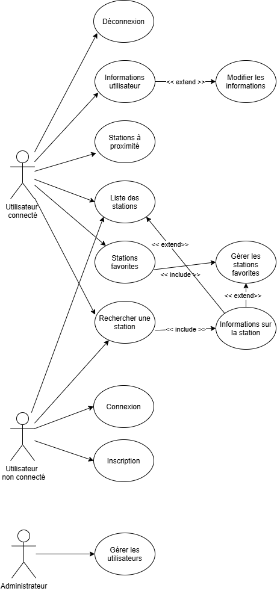{height=30%}

Diagramme de cas d'utilisation
:::

Le diagramme de cas d’utilisation permet de visualiser les options qui s’offrent aux différents types d’utilisateurs lorsqu'ils manipulent l’application. Les trois types d'utilisateur sont ici séparés pour distinguer leurs options spécifiques. 

Un utilisateur non connecté ne peut que rechercher des stations et accéder à la liste des stations pour avoir des informations sur celles-ci. La page "informations sur la station" est directement accessible mais renvoie aux pages de recherche si aucune station n'a été recherchée au préalable. Comme l'utilisateur n’a pas créé de compte, il ne peut pas enregistrer de stations en favori. Il n'a pas non plus accès à la fonctionnalité de recherche de stations à proximité. Il peut accéder à un compte soit en en créant un via la page "inscription" soit en se connectant à un compte déjà existant via la page "connexion". 

Une fois l'utilisateur connecté, il a accès à tous les services qu'offre Veloscope. Il peut ajouter et supprimer des stations de ses favoris ainsi qu'en rechercher via la page "Vélo à proximité". Il peut également modifier les informations de son compte. 

Enfin, les comptes administrateurs disposent de droits particuliers. Ce type de compte est spécifiquement utile pour gestion des comptes existants (activation/désactivation, suppression). Actuellement, seuls les créateurs de l'application possèdent des comptes administrateur. La seule possibilité pour créer un nouveau compte administrateur est de le créer depuis le backend, en précisant le rôle "ADMIN".

## **Diagramme de packages**

Le diagramme de packages modélise l'organisation du code source de l'application VeloScope et les différents liens entre les modules et packages). Pour que l’application reste simple à faire évoluer et facile à maintenir, nous avons choisi de structurer son code en différentes couches. Le projet s’articule ainsi autour de deux grands ensembles complémentaires : le frontend, la partie visible par l’utilisateur, et le backend, qui prend en charge les calculs, la logique du programme et la sauvegarde des données. 

Le package `business_object` regroupe toutes les classes métiers de l'application et comporte huit modules :

-	Le module `station_information` qui contient la classe StationInformation représentant les informations statiques d'une station (identifiant, nom, coordonnées géographiques, capacité).
-	Le module `station_status` qui contient la classe StationStatus représentant l'état courant d'une station (nombre de vélos disponibles, nombre de docks libres, état opérationnel).
-	Le module `station_status_hourly` qui contient la classe StationStatusHourly représentant les statistiques agrégées par heure d'une station.
-	Le module `station_state` qui contient l'énumération StationState définissant les états possibles d'une station.
-	Le module `system_information` qui contient la classe SystemInformation représentant les métadonnées générales du système de vélos (nom du réseau, …).
-	Le module `user` qui contient la classe User représentant un utilisateur de l'application, avec ses attributs d'authentification et de rôle.
-	Le module `user_favorite_station` qui contient la classe UserFavoriteStation représentant l'association entre un utilisateur et une station favorite.
-	Le module `user_role` qui contient l'énumération UserRole définissant les rôles possibles des utilisateurs (USER, ADMIN).

Le package `dao` regroupe les classes DAO (Data Access Object) qui font le lien entre les classes métiers et la base de données PostgreSQL. Il comporte six modules :

-	Le module `station_dao` qui contient la classe StationDAO ayant le contrôle de la table station_information, et permettant notamment la recherche de stations par identifiant, par proximité géographique et par nom.
-	Le module `station_status_dao` qui contient la classe StationStatusDAO ayant le contrôle de la table station_status, et permettant de récupérer le statut courant ou l'historique d'une station.
-	Le module `station_status_hourly_dao` qui contient la classe StationStatusHourlyDAO ayant le contrôle de la table station_status_hourly, et permettant de récupérer les statistiques horaires et journalières agrégées.
-	Le module `favorite_station_dao` qui contient la classe FavoriteStationDAO ayant le contrôle de la table user_favorite_station, et permettant d'ajouter, supprimer, lister et compter les stations favorites des utilisateurs.
-	Le module `system_information_dao` qui contient la classe SystemInformationDAO ayant le contrôle de la table system_information, utilisée pour stocker les métadonnées du réseau de vélos.
-	Le module `user_dao` qui contient la classe UserDAO ayant le contrôle de la table user, et permettant la création, la recherche, la mise à jour et la suppression de comptes utilisateurs.

Ce package importe le package business_object afin de manipuler les instances des classes métiers, ainsi que le package utils afin d'obtenir la connexion à la base de données via la classe DbConnection.

Le package `service` :

-	Le module `station_service` qui contient la classe StationService, qui gère les opérations sur les stations : récupération par identifiant, liste avec filtres, statut courant, historique et calcul de recommandations géolocalisées.
-	Le module `favorite_station_service` qui contient la classe FavoriteStationService, qui gère la logique métier liée aux stations favorites des utilisateurs. 
-	Le module `user_service` qui contient la classe UserService, qui gère l'inscription, l'authentification, la déconnexion et la mise à jour des utilisateurs. 


Le package `controller` regroupe les routeurs FastAPI qui reçoivent les requêtes HTTP entrantes et les délèguent aux services appropriés. 

-	Le module `station_controller` qui contient le routeur gérant les endpoints de consultation des stations (recherche, statut courant, historique, recommandations)
-	Le module `auth_and_user_controller` qui contient le routeur gérant les endpoints d'authentification (inscription, connexion, déconnexion) et de gestion du compte utilisateur (consultation, mise à jour). 
-	Le module `favorite_station_controller` qui contient le routeur gérant les endpoints des stations favorites (ajout, suppression, liste, comptage)
-	Le module `admin_controller` qui contient le routeur réservé aux administrateurs, permettant la gestion des utilisateurs avec des droits élevés.

Le package `utils` regroupe les utilitaires techniques transversaux partagés par l'ensemble des autres packages du backend. Il comporte six modules, comme :

-	Le module `db_connection` qui contient la classe DbConnection
-	Le module `security` qui contient les fonctions de hachage des mots de passe et de génération de tokens d'accès utilisateurs.

Le package `pages` dans le frontend regroupe les pages de l'interface utilisateur Streamlit, chaque module correspondant à une page de l'application. Il comporte dix modules :

-	Le module `home` qui affiche la page d'accueil de l'application.
-	Le module `connexion` qui gère le formulaire de connexion et stocke le token d'accès.
-	Le module `inscription` qui gère le formulaire d'inscription d'un nouvel utilisateur.
-	Le module `admin` qui affiche l'interface de gestion des utilisateurs, accessible uniquement aux administrateurs.
-	Le module `station_search` qui permet la recherche d'une station par nom ou par critères.
-	Le module `list_stations` qui affiche la liste paginée des stations disponibles.
-	Le module `station_info` qui affiche les détails d'une station sélectionnée (statut courant, historique, recommandations).
-	Le module `favorite_stations` qui affiche et gère la liste des stations favorites de l'utilisateur connecté.
-	Le module `velo_a_proximite` qui affiche les stations proches d'une position géographique donnée.
-	Le module `user_info` qui affiche et permet la mise à jour des informations du compte utilisateur connecté.

Ce package importe le package `utils` du frontend afin d'effectuer les appels HTTP vers l'API backend.

## **Diagramme de classes**

Afin de concilier exhaustivité technique et lisibilité, la modélisation orientée objet de VeloScope est découpée en 3 diagrammes complémentaires : les **objets métier** (modèle de domaine pur), l'**architecture en couches du Web Service** (traitement des requêtes HTTP) et le **sous-système d'ingestion et d'agrégation** (collecte GBFS et calcul des indicateurs horaires en arrière-plan).

### Modèle de domaine et entités métier (*Business Objects*)

Les entités métier regroupées dans le module `business_object` constituent le socle sémantique de l'application. Ce sont des objets Python purs, totalement indépendants des bibliothèques d'infrastructure (FastAPI, Pydantic, PostgreSQL ou client HTTP).

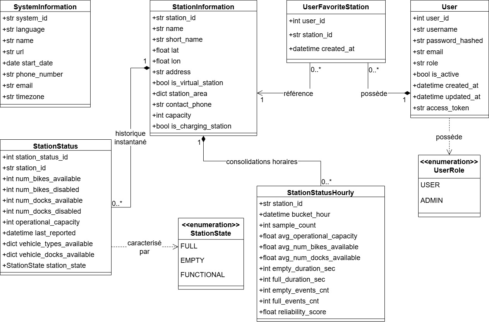{#fig-cd1 width=100%}

Ce modèle s'articule autour de six classes métier et deux énumérations : `SystemInformation` encapsule les métadonnées globales de l'opérateur, `StationInformation` représente le référentiel statique d'une station et `StationStatus` modélise un instantané de télémétrie haute fréquence caractérisé par l'énumération `StationState`. `StationStatusHourly` synthétise quant à elle les statistiques consolidées sur une tranche horaire (`bucket_hour`), incluant le score de fiabilité (`reliability_score`), tandis que `User` (associé à `UserRole`, statut logique, mot de passe haché et jeton de session) et `UserFavoriteStation` gèrent les comptes applicatifs et leurs stations favorites.

Le choix de distinguer `StationStatus` et `StationStatusHourly` dès le modèle de domaine répond à une contrainte de volumétrie : une collecte, toutes les 5 minutes, génère environ 288 relevés par jour et par station (soit plus d'un million d'enregistrements par mois à l'échelle d'un réseau urbain d'une centaine de stations). Isoler la télémétrie brute des agrégats horaires permet d'interroger efficacement les tendances sur 24 heures, 7 jours ou 30 jours sans recalcul coûteux.

### Architecture logicielle du Web Service

Le Web Service adopte une architecture en couches stricte et unidirectionnelle (**Contrôleurs $\rightarrow$ Services $\rightarrow$ DAO $\rightarrow$ Base de données**). Chaque couche occupe un niveau unique et bien délimité, sans appel transversal ni contournement de responsabilité :

{#fig-cd2 width=100%}

- **Couche Contrôleurs** : quatre routeurs FastAPI assurent exclusivement la réception des requêtes HTTP, la validation des schémas Pydantic, la vérification des droits d'accès via injection de dépendances et la traduction des retours métier en codes de statut HTTP.
- **Couche Services** : trois services centralisent la logique métier. `StationService` orchestre notamment la consultation, le calcul du taux de remplissage, l'assemblage des historiques multi-périodes et le moteur de recommandation à proximité.
- **Couche d'accès aux données** : cinq classes DAO encapsulent l'ensemble des requêtes SQL PostgreSQL et s'appuient sur l'objet `DbConnection` pour obtenir une connexion du pool. Plutôt que de regrouper toutes les requêtes liées aux stations dans un unique DAO monolithique, chaque table possède son propre DAO. Ce découpage respecte le principe de responsabilité unique en séparant des logiques SQL très distinctes. Il permet également d'injecter uniquement la dépendance nécessaire dans chaque composant, tout en facilitant les tests unitaires dédiés par table.

### Sous-système d'ingestion et d'agrégation en arrière-plan

Le troisième diagramme isole les composants exécutés en arrière-plan par le planificateur `APScheduler` pour alimenter la base de données et calculer les agrégats horaires :

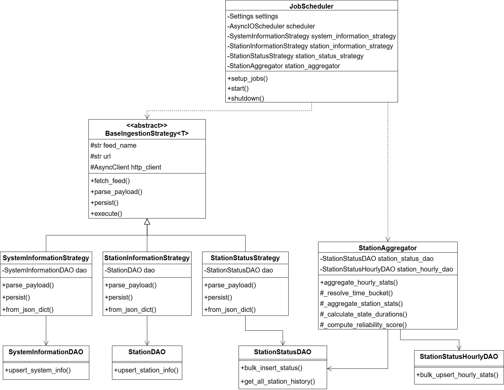{#fig-cd3 width=100%}

Ce sous-système repose sur `JobScheduler`, qui configure et cadence les tâches périodiques via `AsyncIOScheduler`, sur la classe abstraite générique `BaseIngestionStrategy[T]` déclinée en trois stratégies concrètes (`SystemInformationStrategy`, `StationInformationStrategy`, `StationStatusStrategy`), et sur `StationAggregator`, chargé de consolider périodiquement les statuts bruts en `StationStatusHourly`.

Il est important de souligner que ce sous-système ne constitue pas une seconde couche Service concurrente, mais un pipeline d'ETL (*Extract-Transform-Load*) exécuté en arrière-plan, découplé des requêtes HTTP et convergeant vers les mêmes classes DAO que le Web Service. Ce découplage par rapport à `StationService` repose sur les justifications architecturales majeures :

- **Séparation Service applicatif vs ETL, et réactivité utilisateur** : `StationService` doit répondre aux requêtes API en quelques dizaines de millisecondes à partir de PostgreSQL. Déclencher des appels réseau distants vers l'API GBFS externe au sein de `StationService` bloquerait les requêtes des utilisateurs.
- **Principe de responsabilité unique et patron Stratégie** : `StationService` se concentre sur l'interrogation et la recommandation, tandis que `BaseIngestionStrategy` isole la récupération HTTP, la normalisation de formats GBFS hétérogènes et l'insertion par lots. L'ajout d'un nouveau flux se fait par simple héritage sans modifier `StationService`.

## **Structure de la base de données et intégration du standard GBFS**

### Schéma relationnel et stratégie d'indexation

La base de données PostgreSQL est organisée au sein d'un schéma dédié `veloscope` composé de six tables, conçues pour garantir à la fois l'intégrité référentielle et la performance des requêtes temporelles :

{#fig-erd width=100%}

La table `system_information` stocke les métadonnées globales du réseau comme un singleton sans clé étrangère vers `station_information`, car VeloScope gère un réseau urbain configuré par instance (propager `system_id` introduirait une redondance inutile). Le cœur opérationnel associe le référentiel statique `station_information` à l'historique haute fréquence `station_status` ainsi qu'à la table de consolidation horaire `station_status_hourly`, identifiée par la clé primaire composite `(station_id, bucket_hour)` et regroupant moyennes, compteurs/durées critiques et `reliability_score`. Enfin, `user` (avec `username`, `email` et `access_token` `UNIQUE`) et la table d'association `N:N` `user_favorite_station`, munie de la clé primaire composite `(user_id, station_id)` interdisant les doublons, gèrent les comptes et leurs favoris.

Toutes les clés étrangères pointant vers `station_information` ou `user` portent les clauses `ON DELETE CASCADE ON UPDATE CASCADE` afin de préserver l'intégrité. Quatre index ciblés optimisent les chemins critiques : `idx_station_status_station_reported` (`UNIQUE` sur `(station_id, last_reported)`) garantit l'unicité des relevés en lot et accélère l'accès au dernier statut ; `idx_station_hourly_bucket` (`bucket_hour DESC`) accélère les requêtes chronologiques récentes ; `idx_fav_station` (`station_id`) optimise les requêtes inverses sur les favoris ; et `idx_user_access_token` (`UNIQUE` sur `access_token`) assure une résolution immédiate des jetons absents du cache mémoire.

### Sobriété du schéma et pertinence des critères GBFS retenus

Chaque attribut retenu depuis les flux du standard GBFS v2.3 répond à un besoin fonctionnel ou analytique précis. Dans `system_information.json`, les champs `name`, `timezone`, `language` et les coordonnées de contact (`url`, `phone_number`, `email`) fournissent le contexte du réseau et le fuseau horaire de référence. Dans `station_information.json`, `lat` et `lon` alimentent la géolocalisation cartographique et le calcul de distance de Haversine ; `name`, `short_name`, `address` et `capacity` supportent la recherche multicritère et la capacité nominale ; enfin, `is_virtual_station`, `station_area` et `contact_phone` assurent la compatibilité avec les stations hybrides/virtuelles prévues par GBFS v2.3.

Dans `station_status.json`, `num_bikes_available` et `num_docks_available` mesurent l'offre instantanée et permettent de déduire `operational_capacity = num_bikes_available + num_docks_available`, tandis que `last_reported` horodate chaque relevé pour l'historisation et le dédoublonnage. Les indicateurs booléens GBFS (`is_installed`, `is_renting`, `is_returning`) ne sont pas stockés tels quels afin d'éviter des colonnes redondantes, mais évalués dès l'ingestion pour synthétiser `station_state` (`EMPTY`, `FULL`, `FUNCTIONAL`), et `vehicle_types_available` est normalisé au format `{"mechanical": int, "electric": int}` afin de filtrer par motorisation indépendamment des identifiants opérateur.

Enfin, la coexistence des tables `station_status` et `station_status_hourly` constitue un partitionnement temporel applicatif indispensable : interroger directement `station_status` pour afficher une courbe sur 30 jours ou évaluer la fiabilité de dizaines de stations à proximité imposerait de parcourir des centaines de milliers de lignes à chaque appel API. Avec `station_status_hourly`, une requête sur 24 heures ne lit que 24 lignes par station et une requête sur 30 jours au plus 720 lignes (agrégées par jour côté SQL), assurant des temps de réponse constants.

## **Présentation de l'API**

L'API REST de VeloScope est développée avec **FastAPI** et exécutée sur **Uvicorn**, avec génération automatique des documentations OpenAPI (`/docs` et `/redoc`). Les entrées et sorties sont validées par **Pydantic** (journalisation globale des erreurs HTTP `422`), et la persistance repose sur **PostgreSQL** (`psycopg2` via le pool `DbConnection`). L'authentification utilise des jetons **HTTP Bearer** (préfixe `vls30_`), des mots de passe hachés en **SHA-256** et un cache mémoire *thread-safe* (`InMemTokenCache`) purgé à la déconnexion, désactivation ou suppression de compte. L'ensemble est complété par une journalisation HTTP (`LogMiddleware`), du linting/typage statique et une suite de tests isolée sur un schéma PostgreSQL dédié.

Le tableau ci-dessous synthétise les familles d'endpoints exposées (l'inventaire détaillé des 21 routes figure en [Annexe](#annexe-endpoints)) :

| Contrôleur | Préfixe / Routes principales | Accès | Rôle fonctionnel |
| :--- | :--- | :--- | :--- |
| `main` | `/`, `/hello/{name}`, `/db` | Public | Redirection Swagger, disponibilité et sonde PostgreSQL |
| `AuthAndUser` | `/signup`, `/login`, `/logout`, `/user/info` | Public / Bearer | Inscription, authentification, session et gestion du profil |
| `Admin` | `/admin/users` (+ `activate`, `deactivate`, `DELETE`) | Admin | Recherche paginée, activation, désactivation et suppression de comptes |
| `Station` | `/station` (+ `/{id}`, `/status`, `/statuses`, `/history`, `/recommendations`) | Public | Recherche multicritère, statuts temps réel/en lot, historique (`1h` à `30j`) et recommandations |
| `FavoriteStation` | `/favorites` (`GET`, `DELETE`) | Bearer | Ajout, consultation paginée et retrait de stations favorites |

: Synthèse des groupes d'endpoints de l'API REST VeloScope {tbl-colwidths="[16,30,14,40]"}

Trois choix structurent la conception de l'API :

- **Requêtes de recherche et de lot en `POST` (JSON)** : les filtres combinés et la récupération simultanée jusqu'à 500 statuts (`/station/statuses`) passent par des corps JSON validés par Pydantic, évitant la saturation des URL.
- **Cloisonnement sécuritaire** : `UserResponse` n'expose jamais `password_hashed` ; les dépendances `get_current_user` (HTTP `401`) et `get_current_admin` (HTTP `403`) séparent strictement les rôles, tout en empêchant un administrateur de modifier ou supprimer son propre compte (HTTP `400`).
- **Granularité adaptative de l'historique (`TimePeriod`)** : `/station/{station_id}/history` adapte la source selon `period` — relevés bruts (`1h`), agrégats horaires (`24h`) ou moyennes journalières (`7j`, `30j`).

# **Les fonctionnalités**

Les fonctionnalités principales de l’application sont les suivantes : 

- Création d’un compte / connexion 
- Recherche de stations en fonction d’un nom ou d’un identifiant 
- Accès aux informations sur les stations : score de fiabilité, adresse, capacité théorique, coordonnées GPS, ... 

Des fonctionnalités plus avancées sont disponibles pour les utilisateurs connectés : 

- Gestion du compte utilisateur (possibilité de changer les informations) 
- Proposition d’une station à proximité, selon la distance de l’utilisateur à cette station et le score de fiabilité de celle-ci 
- Gestion des stations favorites 

Les administrateurs ont la possibilité de gérer les comptes existants, notamment les supprimer si besoin. 

## **Authentification et gestion des informations utilisateur**

L’authentification est l’une des premières fonctionnalités auxquelles un utilisateur a accès (c’est la raison pour laquelle, dans le frontend, ce sont les deux premières pages accessibles après la page d’accueil). Cela concerne trois actions différentes : l’inscription (la création d’un compte), la connexion à un compte et la gestion des informations après connexion. 

Lorsqu’un utilisateur n’a pas encore de compte, il peut en créer un : pour cela, il a besoin d’entrer un nom d’utilisateur, un email et un mot de passe. Le nom d’utilisateur ne peut pas correspondre à celui d’un utilisateur déjà existant (un message d’erreur s’affiche dans ce cas). Lorsque ces informations sont rentrées, l’utilisateur doit ensuite aller sur la page de connexion pour se connecter à son nouveau compte et peut utiliser les fonctionnalités propres à un utilisateur connecté, voire à celles d’un administrateur en fonction. 

Lorsque l’utilisateur possède déjà un compte et qu’il n’y est pas encore connecté, celui-ci peut le faire sur la page de connexion. Sur cette page, il faut entrer son nom d’utilisateur et son mot de passe pour pouvoir se connecter. Si l’une des deux informations est fausse, un message d’erreur s’affiche et un bouton pour accéder à la page d’inscription apparaît. Si les informations sont bonnes, l’utilisateur est connecté à son compte. 

Lorsqu’un utilisateur est connecté, il peut tout d’abord se déconnecter en allant sur la page d’accueil. Il peut aussi changer ses informations (nom d’utilisateur, email et mot de passe) dans la page « Mon profil ». En effet, sur cette page, l’utilisateur peut consulter ses informations et les modifier. Pour changer ces informations, il suffit juste d’entrer de nouvelles informations (différentes des originales) dans les zones de texte indiquées et correspondant à l’information à modifier. Lorsque du texte est entré, il suffit de recliquer sur la page dans la barre latérale pour voir la nouvelle information ainsi modifiée.  

## **Recherche et consultation de stations**

Les utilisateurs, connectés ou non, peuvent rechercher des informations sur une station en accédant à cette fonctionnalité depuis le menu latéral. Sur la page « Liste des stations », ils peuvent consulter l’ensemble des stations disponibles sur l’application, triées par identifiant. La liste permet de visualiser le nom, l’adresse, la capacité et le statut (empty, functional, full) de chaque station, ainsi qu’un bouton « Info » renvoyant vers sa fiche détaillée. Une fonction de filtrage a également été implémentée pour effectuer une recherche par nom.

Les informations détaillées d’une station sont accessible depuis le menu latéral via l’icône « Informations station », en effectuant une recherche par identifiant ou par nom. Sur cette page, l’utilisateur peut consulter : la disponibilité en temps réel, le score de fiabilité, les caractéristiques de la station ainsi qu'une synthèse synthèse statistique de la station sur une période d’observation (dans la dernière heure, dans les dernières 24 heures, derniers 7 jours et derniers 30 jours. La synthèse contient la moyenne de vélos disponible sur la période, le taux de temps station vide sur la période précédemment, la durée moyenne des pénuries, le pourcentage de temps station saturé, la durée moyenne de saturation ainsi que le score de fiabilité et le taux de remplissage présenté précédemment. 
Une visualisation graphique de cette synthèse est possible. L’utilisateur peut également consulter le tableau complet des relevés sur une période donné.

De plus les utilisateurs connectés ont accès à la recherche de station à proximité. Sur la page « trouver un vélo à proximité », ils peuvent utiliser la recherche soit à partir de sa position actuelle, récupérée directement via la géolocalisation de son navigateur, soit par la saisit d’une adresse. L’utilisateurs peut ajuster sa recherche en modifiant le rayon de recherche, filtré les stations selon leurs capacités opérationnelles, leurs scores de fiabilité et le type de vélo disponible.  Si l’adresse est valide, l’utilisateur peut consulter une carte avec les stations correspondant aux différents critères indiqués en rouge ainsi qu’un tableau répertoriant la distance, la capacités, le statu, le type de vélo et le score de fiabilité pour chaque station trouvée.

## **Gestion des stations favorites**

{height=30%}

Avoir liste de stations favorites est une fonctionnalité clé de toute application de transports en commun, dans notre cas, de stations de vélos urbains. Ainsi, nous avons dû assez rapidement réfléchir à son implémentation au sein de notre application VeloScope. Grâce à cette fonctionnalité, un utilisateur peut plus rapidement accéder à certaines stations en particulier. 

La première limite que nous avons posée pour pouvoir accéder à une liste de stations favorites est celle d’avoir à être connecté à un compte. En effet, au niveau de la base de données, pour qu’une station soit considérée comme préférée par un utilisateur, il pouvoir identifier ce dernier, le meilleur moyen disponible pour le faire étant la connexion à un compte. A partir de cela, nous modélisons la gestion des stations favorites par deux actions à réaliser : l’ajout ou la suppression d’une station à cette liste.  

Pour ajouter une station à la liste des favoris, il faut accéder au menu des informations de la station, dans lequel un bouton permet d’ajouter la station à la liste des favoris. Néanmoins, ce menu n’est pas accessible à partir de celui de la liste des favoris, ainsi, un bouton permettant d’accéder à la liste des stations et un autre au menu de recherche règlent ce problème. Lorsque la station que l’utilisateur veut ajouter est trouvée dans l’un de ces deux menus, celui-ci peut accéder aux informations de la station pour pouvoir l’ajouter aux favoris. 

Il est possible de suivre la même démarche pour supprimer une station de la liste des favoris, le bouton d’ajout étant un bouton de suppression si la station appartient à la liste. Toutefois, le bas de la page permet de choisir l’une des stations de la liste et d’immédiatement la supprimer. Ainsi, la station disparaît de la liste. 

## **Score de fiabilité** {#sec-score-fiabilite}

Le score de fiabilité (compris entre `0` et `100`) évalue la capacité d'une station à assurer durablement la mise à disposition et la restitution de vélos. Calculé chaque heure par `StationAggregator` sur la tranche UTC écoulée $[\text{start\_time}, \text{end\_time})$ (soit $T_{\text{total}} = 3600\text{ s}$), il est persisté dans `station_status_hourly.reliability_score`.

### Reconstitution des durées d'état

À partir des relevés chronologiques d'une station sur l'heure écoulée, `StationAggregator` calcule d'abord les moyennes de capacité et de disponibilité (`_compute_basic_averages`), puis reconstitue les durées d'indisponibilité par maintien d'état entre relevés consécutifs (`_compute_durations_and_events`) : le premier relevé couvre $[\text{start\_time}, t(s_1))$, chaque relevé intermédiaire $[t(s_i), t(s_{i+1}))$ et le dernier $[t(s_{n-1}), \text{end\_time})$ (un relevé unique couvre $T_{\text{total}}$). Les durées cumulées à l'état `EMPTY` (`empty_duration_sec`) et `FULL` (`full_duration_sec`) ainsi que le nombre de transitions vers ces états (`empty_events_cnt`, `full_events_cnt`) sont alors extraits avec garantie de cohérence (une durée non nulle implique au moins un épisode).

### Formulation mathématique du score

La méthode `_compute_reliability_score` combine le taux d'indisponibilité et la durée moyenne (en minutes) des épisodes critiques :

$$
P_{\text{empty}} = \frac{\text{empty\_duration\_sec}}{T_{\text{total}}} \times 100, \qquad
P_{\text{full}} = \frac{\text{full\_duration\_sec}}{T_{\text{total}}} \times 100
$$

$$
D_{\text{empty}} = \begin{cases}
\frac{\text{empty\_duration\_sec} / 60}{\text{empty\_events\_cnt}} & \text{si } \text{empty\_events\_cnt} > 0 \\
0 & \text{sinon}
\end{cases}, \qquad
D_{\text{full}} = \begin{cases}
\frac{\text{full\_duration\_sec} / 60}{\text{full\_events\_cnt}} & \text{si } \text{full\_events\_cnt} > 0 \\
0 & \text{sinon}
\end{cases}
$$

$$
\text{score} = \max\Big(0,\; 100 - \big(w_1 \cdot P_{\text{empty}} + w_2 \cdot P_{\text{full}} + w_3 \cdot \min(100,\; D_{\text{empty}} + D_{\text{full}})\big)\Big)
$$

avec $w_1 = 0{,}55$, $w_2 = 0{,}35$ et $w_3 = 0{,}10$ (arrondi à 2 décimales). La justification détaillée de ces pondérations (asymétrie pénurie/saturation, effet de persistance) ainsi que l'agrégation sur les fenêtres longues (7 et 30 jours) sont présentées en [Annexe](#annexe-fiabilite).

## **« Je veux un vélo à proximité » :** Recommendation de vélo à proximité d'un lieu donné

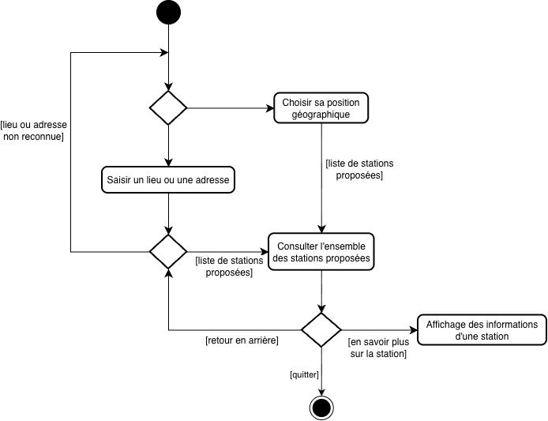{height=30%}

La cinquième fonctionnalité de notre application indiquée dans le cahier des charges nous demandait d’implémenter la possibilité à un utilisateur de trouver des stations à proximité d’une position donnée en fonction de critères précis (comme le score de fiabilité). Nous avons fait le choix de ne laisser cette fonctionnalité accessible uniquement aux utilisateurs connectés, pour leur donner un avantage à avoir créé un compte sur l’application. 

Lorsque l’utilisateur connecté arrive sur la page, deux choix s’offrent à lui : choisir sa position actuelle (celle de sa machine) ou choisir un lieu ou une adresse qu’il doit entrer dans la barre de texte consacrée. Dans les deux cas, le système reconnaît les coordonnées GPS (latitude et longitude) qui sont liées au lieu donné. À partir de cela, le code peut ainsi réaliser des calculs pour trouver l’ensemble des stations qui se trouvent à proximité à partir d’un calcul qui utilise la formule de Haversine (cf. [calcul de la formule de Haversine](#haversine) en annexe).  

Si aucune station n’est trouvée, un texte s’affiche l’indiquant. Dans le cas inverse, une carte apparaît affichant la position géographique des stations déterminées par le code qui correspondent aux critères donnés. Une liste de stations s’affiche aussi en-dessous de la carte, permettant aux utilisateurs de connaître notamment le nom, l’adresse de la station, et d’accéder à ses informations dans la page associée. 

## **Administrateur :** gestion des comptes utilisateurs existants

Réservé aux utilisateurs disposant des droits d'administrateur, cet espace permet de consulter l'ensemble des comptes créés sur l'application et de gérer leur état d'activation. Lorsqu'un administrateur accède à la page, la liste des utilisateurs s'affiche sous forme de tableau indiquant notamment leurs identifiants, informations de compte et statut actif ou inactif. À partir de cette vue, l'administrateur peut sélectionner un compte précis pour l'activer ou le désactiver en un clic, ce qui met immédiatement à jour l'état du compte et révoque le jeton d'accès en cours si le compte est désactivé, avec un rafraîchissement automatique de l'affichage après chaque action.

## **Maintien à jour de la base de données**

### Orchestration temporelle via `APScheduler`

Le maintien à jour de la base est piloté en arrière-plan par `JobScheduler`, démarré et arrêté automatiquement par le gestionnaire `lifespan` de FastAPI (`main.py`) en même temps que le client `httpx.AsyncClient` et le pool `DbConnection`. Il s'appuie sur `AsyncIOScheduler` et des déclencheurs `CronTrigger` alignés sur l'horloge système :

| Identifiant du job | Déclencheur (`CronTrigger`) | Exécution au démarrage | Composant appelé | Rôle |
| :--- | :--- | :--- | :--- | :--- |
| `job_system_information` | `minute=0` (1 fois / heure) | Oui | `SystemInformationStrategy.execute` | Mise à jour des métadonnées réseau |
| `job_station_information` | `minute=0` (1 fois / heure) | Oui | `StationInformationStrategy.execute` | Mise à jour du référentiel stations |
| `job_station_status` | `minute="*/5"` (toutes les 5 min) | Oui | `StationStatusStrategy.execute` | Collecte des statuts temps réel |
| `job_station_aggregation` | `minute=5` (1 fois / heure à `:05`) | Non | `StationAggregator.aggregate_hourly_stats` | Consolidation horaire et fiabilité |

: Planification des tâches de fond sous `APScheduler` {tbl-colwidths="[22,18,12,26,22]"}

### Pipeline d'ingestion, agrégation horaire et persistance idempotente

L'ingestion applique les patrons Méthode Template et Stratégie autour de `BaseIngestionStrategy[T]` : sa méthode `execute()` enchaîne `fetch_feed()`, `parse_payload()` et `persist()` dans un bloc `try/except` journalisé afin qu'une erreur réseau transitoire n'interrompe jamais le planificateur. Les URLs des trois flux GBFS étant externalisées dans `Settings` (`.env`), VeloScope peut basculer vers un autre réseau conforme à GBFS sans modifier le code. Lors du traitement des statuts, `StationStatusStrategy` absorbe les variations entre opérateurs (`snake_case`/`camelCase`, classification des véhicules en `{"mechanical": int, "electric": int}` par normalisation Unicode et expressions régulières), calcule `operational_capacity` et détermine `StationState` (`EMPTY` si la station est non installée, non louable, de capacité nulle ou sans vélo ; `FULL` si aucune borne n'est libre ou le retour impossible ; `FUNCTIONAL` sinon).

En complément de la collecte, la tâche `job_station_aggregation` déclenche `StationAggregator.aggregate_hourly_stats` chaque heure à la minute `:05` — un décalage garantissant que le relevé de `:00` est bien persisté avant consolidation. Le module extrait en une requête l'ensemble des statuts bruts de l'heure UTC écoulée $[H-1\text{h}00, H\text{h}00)$ via `StationStatusDAO.get_all_station_history`, calcule pour chaque station les moyennes de disponibilité, les durées/épisodes critiques et le score de fiabilité (détaillé en section [Score de fiabilité](#sec-score-fiabilite)), puis enregistre les objets `StationStatusHourly` en lot via `StationStatusHourlyDAO.bulk_upsert_hourly_stats`.

Enfin, les écritures en base sont conçues pour être performantes et idempotentes : `StationStatusDAO.bulk_insert_status` insère par lots de 1 000 lignes (`execute_values`) avec `ON CONFLICT (station_id, last_reported) DO NOTHING` pour ignorer tout doublon, tandis que `SystemInformationDAO.upsert_system_info`, `StationDAO.upsert_station_info` et `StationStatusHourlyDAO.bulk_upsert_hourly_stats` emploient `ON CONFLICT ... DO UPDATE` afin de mettre à jour le référentiel (système et stations) ou de rejouer une agrégation horaire sans effet de bord.

# **Structure du code**

## **Architecture du code**

Le projet est structuré en deux partis principal correspondant aux deux composantes de l'application : le répertoire `backend/` et le répertoire `frontend/`. Cette séparation permet indépendance entre les deux parties. Chaque répertoire dispose de son propre fichier de configuration, et de son propre `README`. Le projet contient également un répertoire `data/` qui regroupe les scripts SQL d'initialisation et de la base de données, ainsi que leurs équivalents dédiés aux tests, et un répertoire `doc/` contenant la documentation du projet, les notes de suivi hebdomadaire et le rapport.

**Structure du backend :**

Le code source du backend est situé dans le répertoire `backend/src/` et se décompose en sept packages Python, et un fichier `main.py`. L'application a une architecture par couche :

-	La couche `controller` reçoit les requêtes HTTP et les délègue à la couche service 
-	La couche `service` applique la logique métier et fait appel à la couche dao 
-	La couche `dao` accède à la base de données PostgreSQL et manipule les objets de la couche business_object 
-	La couche `business_object` définit les entités du domaine métier.

Les packages `schema`, `dependencies` et `utils` jouent un rôle transversal : 

- `schema` fournit les modèles de validation des requêtes et réponses HTTP via Pydantic ;
- `dependencies` centralise l'injection de dépendances FastAPI afin d'instancier et de distribuer les objets DAO et service ;
- `utils` regroupe les utilitaires techniques partagés (connexion à la base de données, sécurité, journalisation, paramètres de configuration).

Le sous-package `service/schedule/` gère les traitements automatiques planifiés, décomposés en deux sous-packages : `data_ingestion/` qui implémente les stratégies d'ingestion des flux de données GBFS provenant de l'API externe, et `data_aggregation/` qui calcule et persiste les statistiques horaires à partir des données brutes.

**Structure du frontend :**

Le code source du frontend est situé dans le répertoire `frontend/src/` et se décompose en deux packages et un fichier `app.py`.

Le package `pages/` contient un module par page de l'interface (accueil, connexion, inscription, recherche de stations, liste des stations, fiche d'une station, stations favorites, vélos à proximité, informations du compte utilisateur, administration). Chaque module est indépendant et communique avec le backend via le client HTTP fourni par le package `utils/`.

Le package `utils/` regroupe les utilitaires partagés par les pages.

```text
ensai-it-project-2a-team30/
├── backend/                  # REST API & background services
│   ├── src/
│   │   ├── business_object/  # Domain entities (User, StationStatus, etc.)
│   │   ├── controller/       # FastAPI endpoints & routers
│   │   ├── dao/              # PostgreSQL Data Access Objects
│   │   ├── dependencies/     # Dependency injection (DB, HTTP, Scheduler)
│   │   ├── schema/           # Pydantic request & response models
│   │   ├── service/          # Business logic, aggregations, recommendation
│   │   └── utils/            # DB connection pool, configuration & logging
│   ├── tests/                # Unit and integration tests (pytest)
│   └── README.md             # Developer documentation
├── frontend/                 # Interactive Streamlit application
│   ├── src/
│   │   ├── pages/            # Multi-page views (Search, Favorites, etc.)
│   │   └── utils/            # API client & session helpers
│   └── README.md             # Frontend guide
├── data/                     # Database creation & seed scripts
│   ├── init_db.sql           # Schema definition (veloscope)
│   ├── init_db_test.sql      # Isolated test schema (veloscope_test)
│   ├── star_rennes/          # Jeu de données LE vélo STAR (Rennes : 57 stations)
│   └── velhop_strasbourg/    # Jeu de données Vélhop (Strasbourg : 40 stations)
└── README.md                 # User guide
```

## **Tests**

Les tests du backend sont situés dans le répertoire backend/tests/ et se répartissent en deux sous-répertoires selon la couche testée :

- `tests/test_dao/` qui contient les tests d'intégration des classes DAO. Ces tests s'exécutent avec une connexion réelle à une base de données PostgreSQL de test, initialisée par scripts SQL. Ils vérifient que les requêtes SQL produisent les résultats attendus pour chaque opération.
-	`tests/test_service/` qui contient les tests des classes de service. Selon les cas, ces tests utilisent soit des mocks pour isoler la logique métier de la couche DAO, soit une connexion réelle à la base de données.

# **Guide d'utilisation**

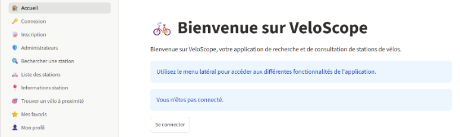

La page d’acceuil a pour but de présenter brièvement l'application puis de proposer à l'utilisateur de naviguer via le menu latéral et de se connecter afin d'accéder aux fonctionnalités utilisateur.

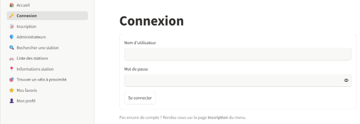

La page de connexion permet à l'utilisateur de se connecter simplement, s'il possède déjà un compte et donc d'accéder aux fonctionnalités utilisateurs. 

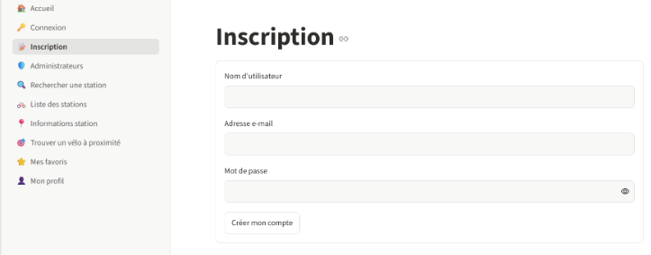

La page Inscription permet à un tout nouvel utilisateur (qui ne possède pas encore de compte) de s'en créer un. Après s'être inscris, il lui suffira de se connecter en utilisant seulement son identifiant et son mot de passe. Il pourra ensuite accéder à davantage de fonctionnalités de l'application. Une fois connecté, on peut se déconnecter si on le souhaite via la page d’accueil.

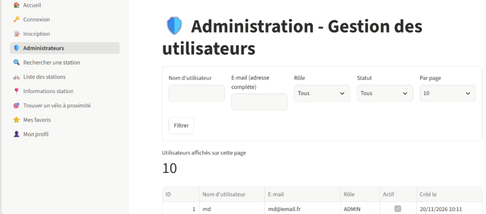

C'est ici que les administrateurs (les membres du groupe) peuvent gérer les comptes des différents utilisateurs, avec un système permettant de filtrer la recherche par différents moyens (pseudos, mail, etc...). Un fois trouvé, l'utilisateur peut voir son compte activé/désactivé ou supprimé. 

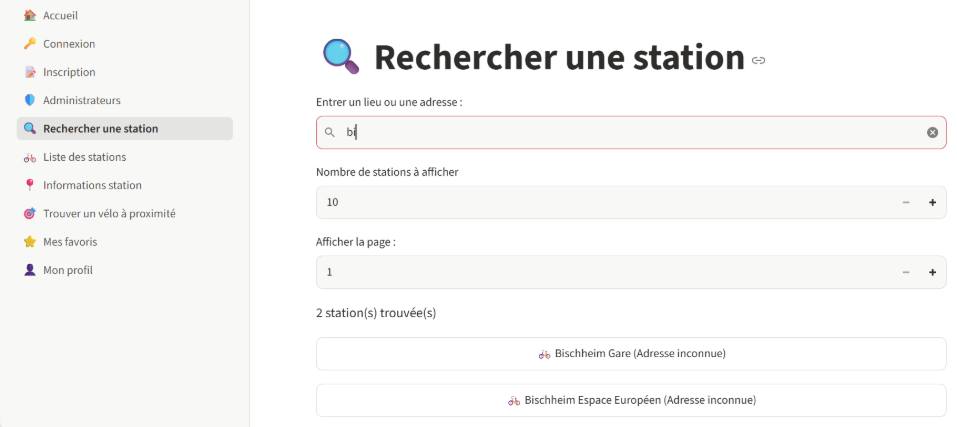

Une page est dédiée à la recherche de stations. On peut rechercher une station par son adresse ou son nom directement. En rentrant simplement une suite de caractère sans taper le nom d’une station en entier, la page affiche toutes les stations contenant cette suite de caractère dans leur nom. Il est possible de choisir le nombre de stations à afficher par pages. Ici, 2 stations ont été trouvées par exemple. Cliquer sur une station envoie vers la page d’informations de celle-ci. 

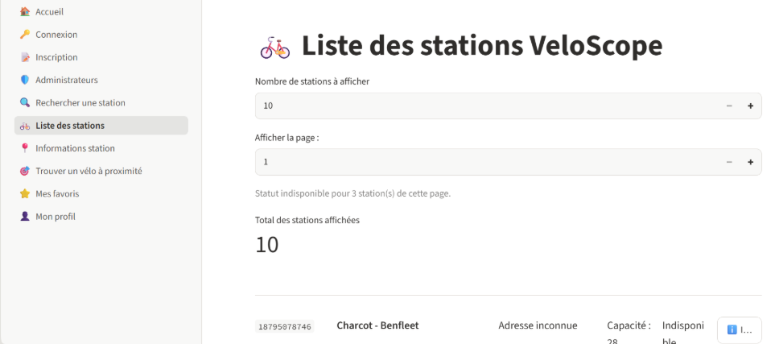

Une page permet également d’accéder à la liste de toutes les stations disponibles dans l’application. Cliquer sur le lien bleu associé envoie vers la page d’informations de la station.

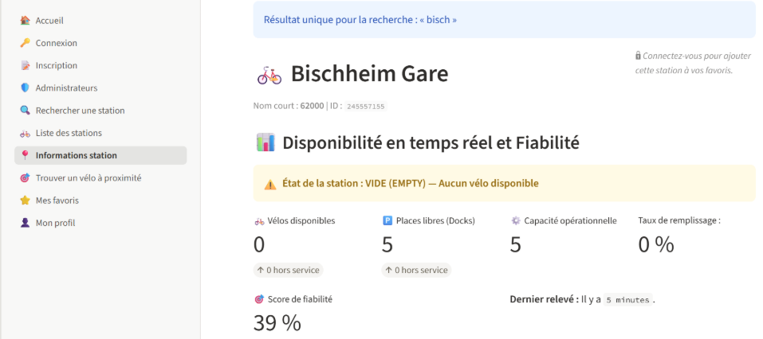

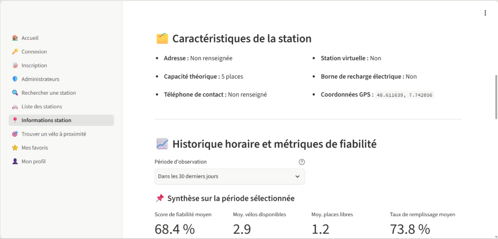

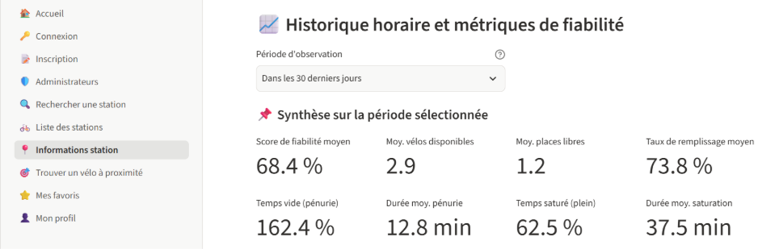

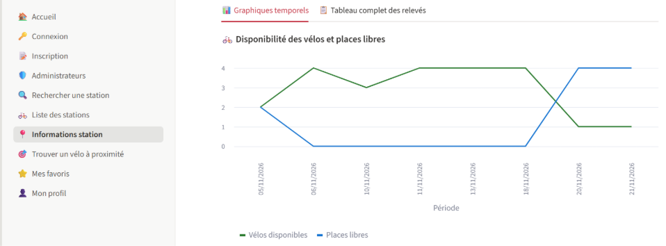

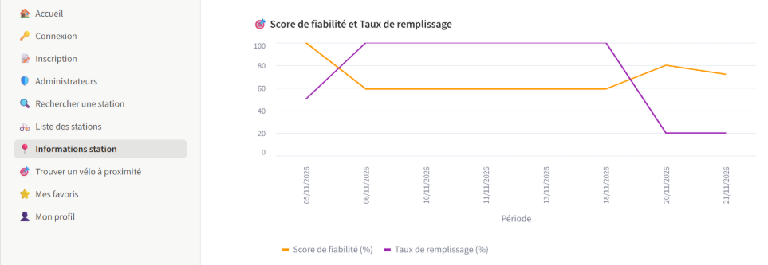

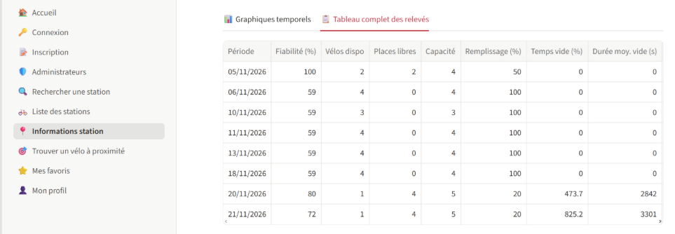

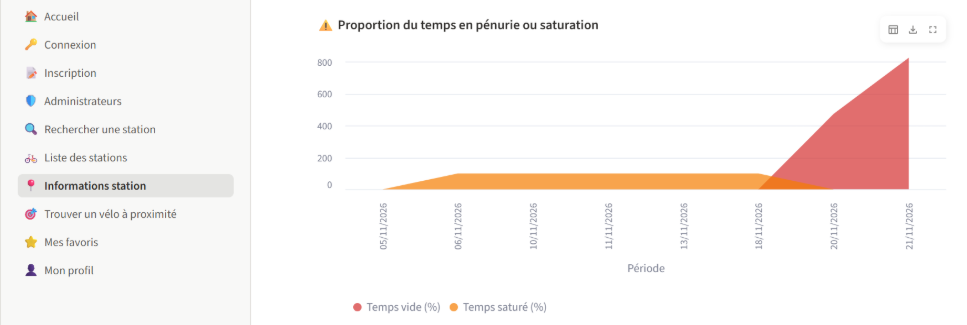

Une fois une station recherchée, on peut retrouver ses informations sur la page “Informations station”. Ces informations peuvent être utiles à l'utilisateur : elles transcrivent de plusieurs manières différentes l’évolution de la fiabilité de la station (chiffres, graphes, tableaux, ...). Cette page constitue l’intérêt principal de l’application car elle contient toutes les informations pour éclairer le choix de l’utilisateur dans sa recherche de station.

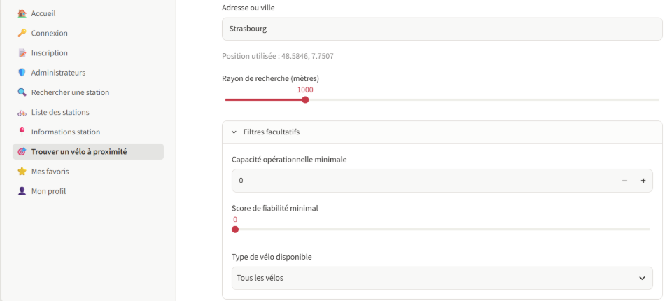

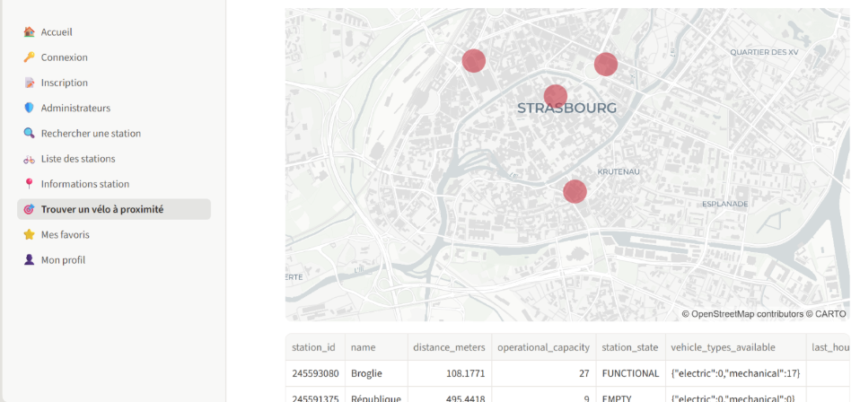

La page « Trouver un vélo à proximité » permet à l'utilisateur de trouver des stations à partir d'une adresse et d’un rayon de recherche. Cette fonctionnalité n’est accessible que si l’utilisateur est connecté et permet d’accéder à une carte des stations. Il peut soit renseigner une adresse soit directement visualiser les stations autour de lui (l’application accède à sa position et lui affiche les stations dans le rayon de recherche).

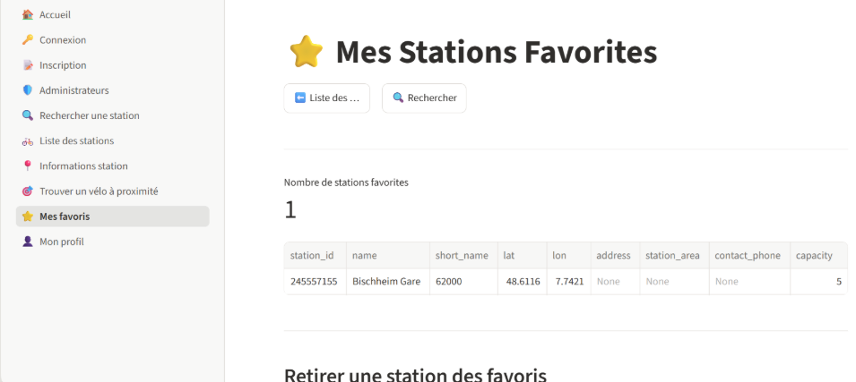

L’utilisateur peut également choisir de mettre certaines stations en favoris et la liste des stations favorites est accessible via une page dédiée. Cela permet de ne pas toujours rechercher une même station que l’on sait fiable. On peut également supprimer des stations favorites depuis cette pages.

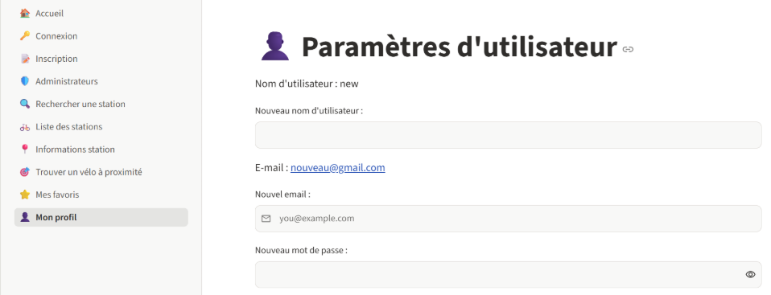

Pour finir, l'utilisateur peut changer ses informations de compte depuis la page “Mon profil”. Il peut changer son nom d’utilisateur, son email et/ou son mot de passe.



# **Conclusion** {.unnumbered}

Pour conclure, notre application contient l'ensemble des fonctionnalités obligatoires présentes dans le cahier des charges. Elle ne contient cependant pas de fonctionnalités optionnelles car nous avons préféré nous concentrer un maximum sur les fonctionnalités primordiales. 

Au cours des différentes phases de conception, nous avons toujours veillé à tester notre code. L'ensemble des classes a été testé pour nous assurer que l'application fonctionne correctement. Cela nous permettait d'avoir toujours confiance en notre travail pour passer à l'étape suivante. Le codage du frontend nous a également pris une partie non négligeable de notre temps de développement. Nous avons essayé d'optimiser au maximum l'ergonomie de l'application, de façon à ce que la navigation soit agréable pour l'utilisateur. 

Ce projet reste une expérience enrichissante pour l'ensemble du groupe. Chacun a pu mettre à profit ses compétences pour que le projet avance au mieux. Nous n'avons pas jugé nécessaire de nous répartir des « rôles » précis tout au long du projet. Chacun a pu travailler intuitivement sur les parties qui l'attiraient le plus. Enfin, nous tenons à remercier M. RIVIÈRE pour le suivi régulier porté à notre groupe. 

Nous espérons que l'application saura vous satisfaire autant qu'elle nous satisfait, et bonne navigation sur Veloscope !



# **Annexes** {.unnumbered}

## **Diagramme de packages** {.unnumbered}

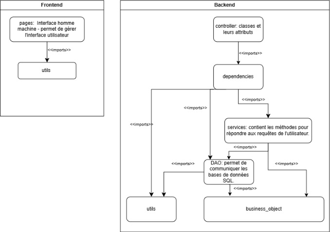{height=40%}

## **Spécificités techniques PostgreSQL** {.unnumbered}

Plusieurs fonctionnalités propres à PostgreSQL ont été exploitées pour répondre aux besoins de l'application : 

- **Isolation par schéma** (`CREATE SCHEMA IF NOT EXISTS veloscope`) : cela regroupe tous les objets de l'application dans un espace de noms dédié, évitant les collisions de noms (notamment avec la table "user"). 
- **Clés auto-incrémentées standards** (`GENERATED BY DEFAULT AS IDENTITY`) : elles sont utilisées pour station_status_id (`BIGINT`) et user_id (`INTEGER`) et garantissent une génération fiable d'identifiants uniques. 
- **Gestion fine des fuseaux horaires** (`TIMESTAMPTZ`) : les horodatages (`last_reported`, `bucket_hour`, `created_at`, `updated_at`) sont stockés avec fuseau horaire (`TIMESTAMPTZ`), ce qui évite les ambiguïtés temporelles lors des calculs d'historique. 
- **Indexation ciblée** (`CREATE INDEX` / `CREATE UNIQUE INDEX`) : `idx_station_status_station_reported` (unique sur `station_id` et `last_reported`) empêche les doublons de relevés pour une même station au même instant et accélère la récupération chronologique des statuts. 

## **Choix de logique et de modélisation** {.unnumbered}

Le modèle est inspiré du standard GBFS (*General Bikeshare Feed Specification*) : la séparation entre `station_information` (coordonnées GPS, adresse, ...) et `station_status` (vélos/places disponibles, vélos/places hors service, ...) reflète la distinction entre les caractéristiques propres aux stations et l'état des stations en temps réel. 

Pré-agrégation horaire (`station_status_hourly`) : plutôt que de recalculer à la volée des moyennes et des durées de saturation sur de grands volumes de relevés bruts, ces tables dédiées stockent les métriques par créneau horaire. Cela améliore les performances des tableaux de bord et graphiques temporels. 

Intégrité référentielle en cascade (`ON DELETE CASCADE` / `ON UPDATE CASCADE`) : les relations vers `station_information` et "user" propagent automatiquement les suppressions et mises à jour de clés. Cela évite de casser les liens entre les tables (par exemple lorsqu'une station ou un compte utilisateur est supprimé). 

## Calcul de la proximité des stations {#haversine .unnumbered}

Dans l’API externe, chaque station a des coordonnées géographiques qui lui sont associées. Avec cela, nous avons accès à la latitude et à la longitude de chaque station. C’est notre cinquième fonctionnalité, « Je veux un vélo à proximité », qui en fait usage (des fonctionnalités optionnelles aussi mais nous ne les avons pas implémenté). Pour pouvoir faire des calculs de distance à partir d’un rayon donné, il nous a fallu utiliser une formule pour utiliser des coordonnées et ainsi obtenir une distance. C’est pour cela que nous avons fait le choix de la **formule de Haversine**. À partir de deux points dont nous avons les coordonnées géographiques en radians, nous pouvons calculer la distance qui les sépare en kilomètres. La latitude et la longitude étant donnés en degrés, il a aussi fallu convertir ces deux mesures en radians en les multipliant par $\frac{\pi}{180}$.

Avec : 

- $\textrm{hav}$ : la fonction haversine 
- $\theta$ : angle en radians quelconque 
- $d$ est la distance du grand cercle entre les deux points 
- $r$ est le rayon de la sphère, 
- $\phi_1,\phi_2$: latitude du point 1 et latitude du point 2, en radians 
- $\lambda_1,\lambda_2$: longitude du point 1 et longitude du point 2, en radians 
$$\textrm{hav}(\theta)=\sin^2\left(\frac{\theta}{2}\right)=\frac{1-\cos(\theta)}{2}$$ 
$$\textrm{hav}\left(\frac{d}{r}\right)=\textrm{hav}(\phi_2-\phi_1)+\cos(\phi_1)\cos(\phi_2)\textrm{hav}(\lambda_2-\lambda_1)$$ 
$$\iff d=2r\arcsin\left(\sqrt{\sin^2\left(\frac{\phi_2-\phi_1}{2}\right)+\cos(\phi_1)\cos(\phi_2)\sin^2\left(\frac{\lambda_2-\lambda_1}{2}\right)}\right)$$

Cette formule est implémentée deux fois dans l’application : 

- **Dans la chouche DAO**, à partir de coordonnées fixes (les arguments de la méthode en question), nous pouvons calculer la distance qui sépare ce point fixé de chaque station. Si la distance évaluée est inférieure au rayon donné, la station est choisie 
- **Dans la couche Service**, la fonction `haversine` du package du même nom calcule le rayon à prendre en compte pour choisir la station entre un point donné dans les arguments de la méthode en question et chaque station. La distance calculée est ensuite affichée dans le frontend. 

## Inventaire complet des endpoints de l'API REST {#annexe-endpoints .unnumbered}

| Méthode & Route | Contrôleur | Accès | Schéma Entrée / Sortie | Rôle fonctionnel |
| :--- | :--- | :--- | :--- | :--- |
| `GET /` | `main` | Public | Redirection $\rightarrow$ `/docs` | Accès direct à Swagger UI |
| `GET /hello/{name}` | `main` | Public | `str` $\rightarrow$ `dict` | Test minimal de disponibilité |
| `GET /db` | `main` | Public | — $\rightarrow$ `dict` (200 / 503) | Sonde de connectivité PostgreSQL |
| `POST /signup` | `AuthAndUser` | Public | `SignupRequest` $\rightarrow$ `MessageResponse` | Création de compte utilisateur |
| `POST /login` | `AuthAndUser` | Public | `LoginRequest` $\rightarrow$ `LoginResponse` | Authentification et émission de jeton |
| `POST /logout` | `AuthAndUser` | Bearer | — $\rightarrow$ `MessageResponse` | Invalidation du jeton en base et cache |
| `GET /user/info` | `AuthAndUser` | Bearer | — $\rightarrow$ `UserResponse` | Consultation du profil connecté |
| `PUT /user/info` | `AuthAndUser` | Bearer | `UserUpdateRequest` $\rightarrow$ `MessageResponse` | Modification du profil connecté |
| `POST /admin/users` | `Admin` | Admin | `UserSearchRequest` $\rightarrow$ `list[UserResponse]` | Recherche paginée des comptes |
| `POST /admin/users/activate/{user_id}` | `Admin` | Admin | `int` $\rightarrow$ `MessageResponse` | Réactivation d'un compte tiers |
| `POST /admin/users/deactivate/{user_id}` | `Admin` | Admin | `int` $\rightarrow$ `MessageResponse` | Désactivation et révocation de session |
| `DELETE /admin/users/{user_id}` | `Admin` | Admin | `int` $\rightarrow$ `MessageResponse` | Suppression définitive d'un compte |
| `GET /station/{station_id}` | `Station` | Public | `str` $\rightarrow$ `StationInfoResponse` | Fiche descriptive d'une station |
| `POST /station` | `Station` | Public | `StationSearchRequest` $\rightarrow$ `list[StationInfoResponse]` | Recherche multicritère paginée |
| `GET /station/{station_id}/status` | `Station` | Public | `str` $\rightarrow$ `StationStatusResponse` | État temps réel et dernier score |
| `POST /station/statuses` | `Station` | Public | `list[str]` ($\le 500$) $\rightarrow$ `dict[str, StationStatusResponse]` | Statuts temps réel en lot pour la carte |
| `GET /station/{station_id}/history` | `Station` | Public | `period` (`1h`/`24h`/`7j`/`30j`) $\rightarrow$ `list[StationStatusResponse]` | Historique multi-échelles et métriques |
| `POST /station/recommendations` | `Station` | Public | `StationRecommendationRequest` $\rightarrow$ `list[StationRecommendationResponse]` | Recommandation de proximité filtrée |
| `GET /favorites/{station_id}` | `FavoriteStation` | Bearer | `str` $\rightarrow$ `MessageResponse` | Ajout d'une station aux favoris |
| `GET /favorites/` | `FavoriteStation` | Bearer | `page`, `size` $\rightarrow$ `list[StationInfoResponse]` | Liste paginée des favoris |
| `DELETE /favorites/{station_id}` | `FavoriteStation` | Bearer | `str` $\rightarrow$ `MessageResponse` | Retrait d'une station des favoris |

: Inventaire des endpoints de l'API REST VeloScope {tbl-colwidths="[25,16,8,27,24]"}

## Justification des pondérations du score de fiabilité {#annexe-fiabilite .unnumbered}

- **Asymétrie entre pénurie et saturation ($w_1 = 0{,}55 > w_2 = 0{,}35$)** : une station vide (ou hors service / non louable, également classée `EMPTY` à l'ingestion) empêche tout usager de démarrer un trajet et pénalise donc plus sévèrement la fiabilité qu'une station pleine, qui n'affecte que le dépôt de fin de trajet.
- **Prise en compte de la persistance ($w_3 = 0{,}10$)** : le terme $\min(100, D_{\text{empty}} + D_{\text{full}})$ distingue des micro-ruptures rapidement corrigées d'une indisponibilité prolongée. Par exemple, pour 20 minutes passées à l'état vide sur une heure ($P_{\text{empty}} = 33{,}33$, $P_{\text{full}} = 0$), un épisode unique continu de 20 minutes ($D_{\text{empty}} = 20$) aboutit à un score de $79{,}67$, contre $81{,}17$ si ces 20 minutes se répartissent en 4 courts épisodes de 5 minutes ($D_{\text{empty}} = 5$). Le plafonnement à $100$ minutes évite qu'un épisode unique ne domine excessivement la pénalité proportionnelle.
- **Agrégation sur les périodes longues** : pour les consultations d'historique sur 7 jours et 30 jours ainsi que pour l'indicateur `last_day_reliability` des recommandations, `StationStatusHourlyDAO.aggregate_daily_stats` et `aggregate_daily_stats_for_stations` calculent la moyenne journalière des scores horaires persistés.

## **Bilan de groupe** {.unnumbered}

### Difficultés rencontrées {.unnumbered}

Les difficultés que nous avons pu rencontrer n’ont jamais été très importantes. Nous avons tout de même fait face à de petits contretemps tout au long du projet. 

La répartition du travail a parfois été inégale. Comme les tâches sont très dépendantes les unes des autres, il a parfois été difficile de ne pas donner plus de travail à un membre qu'à un autre. Par exemple, lorsque l'un de nous avait plus avancé sur la compréhension d'un problème ou d'une partie du sujet, il était facile de lui léguer le travail que cela engendrait par la suite. Ceci a pu provoquer des différences de charge de travail à certains moments du projet. 

La compréhension du sujet n'a pas été constamment aisée non plus. Comme aucun de nous n'avions travaillé sur des données de norme GBFS auparavant, nous n'étions pas familiarisés avec le sujet dès le début. Il nous a parfois fallu prendre du temps pour comprendre les particularités de la structure de la base de données. Par exemple, au commencement du projet, nous avons dû cerner la différence entre la capacité virtuelle d'une station et sa capacité physique. Nous avons réfléchi davantage à la manière de prendre en compte cette différence dans notre application. 

Enfin, tout au long du projet, nous avons naturellement fait face à des erreurs dans notre code (tests, liens frontend/backend, dépendances, etc). Ces problèmes ont été réglés rapidement la plupart du temps, et réfléchir à plusieurs sur leur résolution nous a permis de tous comprendre le code plus profondément. 

Pour élaborer sur ces difficultés rencontrées, nous avons eu des soucis avec les liens entre le frontend et le backend. Par exemple, lorsque nous avions mis à disposition la possibilité de changer de pseudo, le lien n'était pas clairement écrit dans le backend donc le pseudo restait intact dans la base de données. De plus, un problème similaire s'est imposé lorsque nous avons voulu mettre en place la fonctionnalité "supprimer un compte" depuis la page admin. En effet, le bouton était disponible sur le frontend mais le lien depuis le controller n'était pas établi alors que la fonction était pourtant présente dans la classe DAO associée.

### Points forts et points à améliorer pour de futurs projets {.unnumbered}

Les points forts de notre équipe ont été multiples et nous ont permis d'avancer efficacement dans le projet. 

La communication a été de mise : nous avons naturellement créé un groupe WhatsApp entre nous pour nous communiquer régulièrement nos avancées et les problèmes rencontrés. Cela nous permettait d'échanger à distance quand il le fallait, par exemple au moment des différentes échéances ou encore quand un retour par mail nous était fait par le tuteur. Nous avons tenu à nous voir en présentiel assez souvent, avec une réunion par semaine durant la première phase du projet (en plus des cours avec le tuteur les vendredis). Cela a permis d'être sûrs que tout le monde était investi et motivé dans le projet, et de ne pas perdre cette motivation dans le temps. 

Concernant notre gestion de l'application, les conflits git ont été très rares. Chacun de nous a veillé à toujours récupérer le travail des autres avant de faire ses modifications. De plus, notre répartition du travail a permis de ne jamais avoir deux membres qui travaillaient sur le même fichier en même temps. Enfin, nous sommes satisfaits de la façon dont nous sommes "rentrés" dans le sujet au début du projet. Nous avons tous su comprendre rapidement les enjeux de celui-ci et les différents besoins auxquels devait répondre l'application. 

Nous nous accordons cependant sur le fait que certains points sont améliorables. Par exemple, nous avons choisi de ne développer que les fonctionnalités obligatoires du cahier des charges. Il aurait pu être intéressant de se pencher sur au moins l'une des fonctionnalités optionnelles pour donner un coté personnalisé à notre application.

## **Bilan personnel** {.unnumbered}

### Martin DUBOS {.unnumbered .unlisted}

Tout d’abord, j’ai abordé ce projet informatique à reculons dans la mesure où, l’année précédente, j’avais eu l’impression d’être dans le flou durant la première partie, sans vraiment savoir sur quoi travailler. Mais très vite, mon intérêt pour le sujet proposé m’a fait changer d’avis. J’ai trouvé les sujets originaux, bien pensés et bien introduits, ce qui a simplifié la phase d’analyse.

Ce projet m’a permis de mieux comprendre la structure et le fonctionnement de ce type d’application. Le fait d’avoir les vendredis dédiés à l’informatique en début d’année, avec les compléments le matin et le projet l’après-midi, nous a permis d’être beaucoup plus efficaces.

N’étant pas le plus expérimenté du groupe, j’ai contribué à la programmation en implémentant les fonctionnalités et les tests de niveau facile à intermédiaire. J’ai trouvé notre groupe de travail complémentaire. Les conseils et les explications des autres membres de l’équipe m’ont permis de comprendre rapidement les parties du code qu’ils avaient développées. Par ailleurs, j’ai trouvé le fichier de suivi des tâches hebdomadaires partagé sur le dépôt GitHub indispensable, car il incite chaque membre à maintenir un rythme régulier, notamment durant les périodes sans créneaux en classe. Cette organisation a évité que les jours précédant les deadlines ne soient trop surchargés.

Enfin, l’une des principales difficultés rencontrées au démarrage a été de travailler avec des personnes dont je ne connaissais pas encore les points forts, ce qui a rendu la répartition initiale des tâches un peu délicate.

### Minh Quang KIEU {.unnumbered .unlisted}

Ce projet informatique a été une très bonne expérience pour moi, à la fois sur le plan technique et pour le travail en groupe. Au cours du projet, j'ai contribué à la modélisation initiale, au développement du sous-système de collecte et d'agrégation, ainsi qu'à l'amélioration de l'API et des tests sur le backend.

Comme j'avais beaucoup travaillé sur les premiers diagrammes, les critiques lors du rendu intermédiaire sur la complexité et la lisibilité m'ont fait réfléchir. Avec l'aide du groupe, j'ai compris ce qu'il fallait simplifier (suppression de tables annexes, fusion de services proches, découpage en trois diagrammes plus clairs) et ce qu'il fallait mieux expliquer. Cela m'a montré l'importance de viser une conception plus sobre dès le départ et de toujours relier chaque choix technique à un besoin concret. Dans cette même optique d'amélioration, on pourrait également ajouter des tâches planifiées pour supprimer automatiquement les données anciennes (par exemple au-delà de 24 heures pour `station_status` et de 30 jours pour `station_status_hourly`) afin d'économiser des ressources de stockage, ou encore ne renseigner que l'URL racine `gbfs.json` pour découvrir automatiquement les autres flux au lieu de configurer les trois URLs manuellement.

Enfin, j'ai aussi eu une difficulté personnelle avec le français : parfois, je ne comprenais pas tout de suite ce que les autres disaient, ou j'avais du mal à expliquer mes idées clairement. Grâce à l'écoute, à la patience et à la bienveillance du groupe, nous avons réussi à dépasser cette barrière ensemble. Cette expérience m'a permis de progresser en français et de mieux communiquer en équipe.

### Nathan LAIMANT {.unnumbered .unlisted}

J'avais beaucoup d'appréhension vis-à-vis de ce projet car le projet de traitement de données en première année était assez difficile. La programmation en Python étant très différente de celle en R, je n'avais pas très confiance en mes capacités. De plus, lorsque j'ai appris que nous ne choisissions pas les groupes de projet, j'avais assez peur d'être avec des personnes que je ne connaissais pas. Heureusement, ce n'étais pas le cas et nous avons pu assez facilement créer une bonne dynamique de groupe.

J'ai tenté d'être assez polyvalent sur le projet, pour pouvoir apprendre et ne pas laisser mes coéquipiers seuls sans pouvoir les aider sur du code. La partie de modélisation était assez compliquée mais lorsque nous avons pu nous mettre d'accord sur l'organisation plus large du projet, j'ai senti que nous pouvions être très efficaces. Finalement, j'ai très rapidement pu m'habituer au code en Python, notamment grâce aux TP de Compléments informatique qui nous donnait des pistes pour pouvoir coder différentes fonctionnalités. Grâce à cela, j'ai pu rapidement avancer et ai pu aider les autres en cas de souci.

Coder le backend fu assez simple mais chronophage, notamment l'écriture des tests. Lorsque j'ai dû faire mes recherches pour savoir comment implémenter la recherche de stations à proximité à partir des coordonnées GPS, cela fut long. Je dirais que le code du frontend était le plus intéressant car le but est de proposer une expérience utilisateur qui soit intéressante. J'ai bien aimer approfondir la documentation de Streamlit pour découvrir comment implémenter des fonctionnalités pour les rendre le plus unique et pratique possible.

Au final, je suis assez content du projet, notamment car j'ai pu travailler avec des coéquipiers qui y mettaient du leur. Cela m'a appris à devoir respecter des dates limites que nous nous imposons au sein de l'équipe, ce qui change de celles qui sont imposées par l'administration ou les enseignants. Je suis content d'avoir gagner en expérience à ce sujet et espère pouvoir en retirer le maximum plus tard, que ce soit en poste ou dans des hobbies.

### Victor NEMBRINI {.unnumbered .unlisted}

Pour être tout à fait honnête, je ne pensais pas avoir ma place au sein du projet à cause de mon niveau en informatique. Cependant, j’ai pu participer à de nombreuses tâches très diverses : j’ai commencé par le diagramme de Gantt, puis, dans le code, j’ai créé les tables SQL dans les schémas, chose que je n’avais jamais faite avant, et j’ai donc beaucoup appris. 

Ensuite, j’ai participé grandement au code de la classe UserDAO, là aussi j’ai grandement appris car ce concept me paraissait encore un peu flou avant cette application concrète.

Finalement, j’ai terminé sur le frontend et cela m’a permis de me familiariser avec Streamlit, qui est un outil que j’ai apprécié du fait de sa facilité d’utilisation. J’ai notamment codé les pages inscription, connexion, admin et list_stations. Sur la fin, j’ai également revisité le backend, surtout pour corriger les liens entre backend et frontend qui n’étaient pas clairs parfois. 

J’ai très bien vécu le projet que ça soit l’ambiance générale du groupe ou même le travail à fournir, j’ai beaucoup appris par exemple lorsque j’ai dû créé une route delete_user dans le backend car elle n’était pas présente et qu’on avait pourtant ajouté cette fonctionnalité dans le frontend. 

Néanmoins, bien que le projet se soit bien passé dans l’ensemble, je pense que j’aurais pu participer davantage et que je me suis trop focalisé sur le fait que j’allais causer plus de soucis qu’autres choses étant donné mon niveau, ce qui est bête car c’était justement une opportunité d’apprendre.  

### Antonin PRADEL {.unnumbered .unlisted}

Le bilan de ce projet est pour moi positif en tout point. Du début à la fin, j’ai été pleinement investi et satisfait des avancés du groupe. J’ai ressenti les bénéfices de ce projet à la fois au niveau individuel mais aussi collectivement avec mon groupe. 

Individuellement : je considère avoir appris beaucoup de choses durant ces semaines de projet. C’est la première fois que je travaille sur un projet de groupe de cette ampleur et cela m’a permis d’encore mieux maîtriser les outils avec lesquels je serai amené à travailler plus tard (VSCode, Onyxia, ...). Mon niveau en code a évidemment évolué aussi : faire partie prenante du développement de l’application a encore plus concrétisé les concepts que nous avions vu en cours (fonctionnement d’une API, gestion en couches, ...). Au début du projet, je me suis occupé d'une grande partie de la documentation des classes. Cela m'a permis d'avoir une vision d'ensemble de notre application et de comprendre rapidement vers quoi on se dirigeait. 

Je pense qu’il aurait pu être intéressant de se pencher davantage sur une ou deux fonctionnalités optionnelles proposées (comme dit plus haut dans le bilan collectif). Je suis déjà très satisfait de notre application mais une touche d’originalité aurait sûrement rendu le travail plus personnalisé, moins « classique ». Je reste conscient que cela aurait dû être envisagé dès le commencement du projet et qu’il est difficile d’avoir de larges ambitions quand on démarre un projet avec autant de contenu. 

Enfin, je tiens à remercier l’ensemble des collègues du groupe ainsi que notre tuteur, M.RIVIERE, pour ses conseils précieux et son suivi régulier. 
